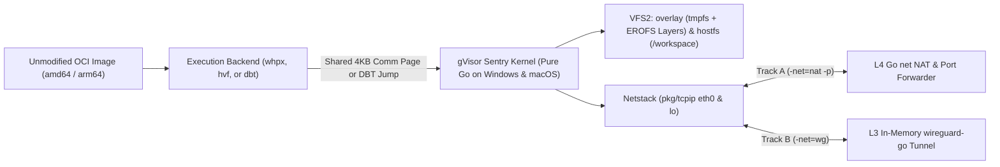

# `gvx`

`gvx` ports Google's gVisor user-space Linux kernel (Sentry) to 64-bit Windows (`windows/amd64`, `windows/arm64`) and macOS (`darwin/arm64`, `darwin/amd64`) as co-equal Priority-0 targets. It executes unmodified Linux ELF64 binaries and multi-arch OCI container images inside one unprivileged host process via the `rungv` CLI or `pkg/gvx` SDK. Callers get isolated Linux execution on Windows and Mac with millisecond startup, no Linux virtual machine, no kernel drivers, and no administrator or `root` privileges.

---

## 1. Architecture and Capability Overview

Running Linux binaries or container images on Windows and macOS usually forces a heavy compromise. WSL2, Docker Desktop, and Apple `Virtualization.framework` boot a full Linux virtual machine that consumes hundreds of megabytes of RAM and requires background virtualization daemons. QEMU emulates an entire motherboard and CPU in software.

`gvx` takes a direct user-space approach. About 65% of upstream `google/gvisor` (`pkg/sentry/kernel`, `pkg/sentry/arch`, `pkg/ring0`, `pkg/sentry/vfs`, `pkg/sentry/fsimpl/{erofs,overlay,tmpfs}`, and `pkg/tcpip`) is OS-agnostic Go code supporting both `amd64` and `arm64`. `tools/upstream` expands those build constraints to `linux || windows || darwin` automatically. Thin host packages bind to Windows (`WinHvPlatform.dll`, `WaitOnAddress`, `MapViewOfFile3`) and macOS (`Hypervisor.framework`, `__ulock_wait`, `mach_vm_remap`) primitives.

| Runtime Model | Host Targets | Cold Start | Memory Overhead | Admin / `sudo` Required | 4KB `mmap(MAP_FIXED)` | Direct OCI Image Run |
| :--- | :--- | ---: | ---: | :--- | :--- | :--- |
| **`gvx` / `rungv` (`whpx` / `hvf`)** | Windows & macOS (`amd64`, `arm64`) | `< 15 ms` | `~18 MiB` | No (Low Integrity / Seatbelt) | Hardware 4KB EPT / Stage-2 MMU | Yes (In-Memory Tar-to-EROFS) |
| **`gvx` / `rungv` (`dbt` Engine)** | Windows & macOS (`amd64`, `arm64`) | `< 20 ms` | `~22 MiB` | No (Low Integrity / Seatbelt) | 4KB `MEM_COMMIT` / `MAP_JIT` | Yes (In-Memory Tar-to-EROFS) |
| **WSL2 / Docker Desktop** | Windows & macOS | `800-2500 ms` | `> 512 MiB` | Yes (VM Daemon / Services) | Guest Linux Kernel MMU | Requires VM Daemon |
| **QEMU (`tcg` Full System)** | Windows & macOS | `1500-4000 ms` | `> 256 MiB` | No | SoftMMU Emulation | Requires Disk Image Build |



---

## 2. Quickstart (Procedural Module)

Run an unmodified OCI image or ELF binary from the CLI via `cmd/rungv`, or embed a sandbox in Go via `pkg/gvx`.

### 2.1 CLI Execution on Windows and macOS (`cmd/rungv`)

Use these steps to compile `rungv` and run an unmodified OCI image on Windows or macOS:

> [!IMPORTANT]
> On Windows, enable the "Windows Hypervisor Platform" feature for `whpx`. On macOS, sign the binary with an ad-hoc `com.apple.security.hypervisor` entitlement (`codesign -s -`) for `hvf`, or pass `-platform=dbt` when virtualization is unavailable.

1. Build `rungv` with the standard Go 1.25+ toolchain (and apply ad-hoc signing on macOS for `hvf`).
2. Run an unmodified OCI image (`nginx:alpine`) with `-p 8080:80` port forwarding and `-net=nat` networking.
3. Pass `-net=wg` with a WireGuard configuration file when strict L3 host LAN isolation is required.

```bash
# Build on macOS (Apple Silicon arm64 or Intel amd64) and apply free ad-hoc hypervisor signature
go build -o rungv ./cmd/rungv
codesign --sign - --entitlements entitlements.plist --force ./rungv

# Or build on Windows (amd64 or arm64)
go build -o rungv.exe ./cmd/rungv

# Track A: Zero-config L4 NAT mode with -p port forwarding and OCI Tar-to-EROFS caching
./rungv run -net=nat -p=8080:80 -image=nginx:alpine -workspace=./my-project

# Track B: Cryptographic L3 WireGuard mode (zero host LAN access, no WinTun.dll or /dev/tun required)
./rungv run -net=wg -wg-conf=./sandbox-wg.conf -image=python:3.12-alpine -workspace=./my-project \
  -- python3 -c "import urllib.request; print(urllib.request.urlopen('https://example.com').status)"
```

### 2.2 Embeddable Go SDK (`pkg/gvx`)

Embed `gvx` inside a Windows or macOS host binary to run sandboxed Linux toolchains without external daemons:

> [!CAUTION]
> Always call `sb.Close()` after `sb.Run()` returns. Omitting `sb.Close()` leaks hypervisor guest physical mappings, cached EROFS handles, the `os.Root` workspace handle, and host sandbox resources. Defer `sb.Close()` immediately after `gvx.New()` succeeds.

1. Construct a `gvx.Config` specifying the execution backend, OCI image or rootfs path, network mode, and workspace path.
2. Call `gvx.New(ctx, cfg)` to compile/open EROFS layers, initialize networking, and apply self-lockdown (`pkg/hostlockdown`).
3. Call `sb.Run(ctx)` to execute the guest binary and read its Linux exit code.

```go
package main

import (
	"context"
	"fmt"
	"os"

	"gvisor.dev/gvisor/pkg/gvx"
)

func main() {
	ctx := context.Background()
	sb, err := gvx.New(ctx, gvx.Config{
		Platform:      gvx.PlatformAuto, // Selects whpx on Windows, hvf on macOS, or dbt fallback
		NetworkMode:   gvx.NetModeNAT,
		OCIImage:      "alpine:3.20",
		WorkspacePath: "./repo",
		Argv:          []string{"/usr/bin/git", "status"},
		Stdout:        os.Stdout,
		Stderr:        os.Stderr,
	})
	if err != nil {
		fmt.Fprintf(os.Stderr, "init sandbox: %v\n", err)
		os.Exit(1)
	}
	defer sb.Close()

	exitCode, err := sb.Run(ctx)
	if err != nil {
		fmt.Fprintf(os.Stderr, "run sandbox: %v\n", err)
		os.Exit(1)
	}
	os.Exit(exitCode)
}
```

---

## 3. Core Mechanics and Invariants (Descriptive Module)

`gvx` resolves six architectural differences between Linux, Windows, and macOS: 4KB vs. 64KB/16KB virtual memory alignment, system call interception latency, dual-track user-space networking, NTFS/APFS-safe OCI image execution, POSIX filesystem semantics, and unprivileged process lockdown.

### 3.1 Hardware and DBT Execution Backends (`whpx`, `hvf`, and `dbt`)

Windows enforces a 64KB alignment granularity on `VirtualAlloc(..., MEM_RESERVE, ...)`, while Apple Silicon macOS enforces a 16KB host page size (`vm_page_size = 16384`). Linux ELF loaders require 4KB alignment for `mmap(MAP_FIXED)`. `gvx` satisfies 4KB page mappings across all backends.

`pkg/sentry/platform/whpx` (Windows `amd64`/`arm64`) and `pkg/sentry/platform/hvf` (macOS `arm64`/`amd64`) map 4KB guest physical pages from `pgalloc.MemoryFile` via `WHvMapGpaRange` and `hv_vm_map`. Hardware Extended Page Tables (`amd64`) and Stage-2 4KB translation granules (`arm64` `TCR_EL1.TG0 = 4KB`) enforce `R/W/X` permissions at native 4KB boundaries. Inside the partition, an in-guest Ring-0/EL1 stub (`bluepill_*.s`) spills guest registers to a shared 4KB page before executing `HLT` or `HVC #0`.

`pkg/sentry/platform/dbt` (Fallback, Milestone M5) runs when hardware virtualization is unavailable. It slices 4KB pages via two-phase `VirtualAlloc` (`MEM_COMMIT` on Windows) or `mmap(MAP_JIT)` (`pthread_jit_write_protect_np` on macOS). The Basic-Block DBT reuses the official zero-allocation Go disassemblers (`golang.org/x/arch/x86/x86asm` on `amd64` and `golang.org/x/arch/arm64/arm64asm` on `arm64`) paired with direct byte-copy passthrough and compact machine-code stencils. It rewrites `SYSCALL` and `SVC #0` into trampoline jumps. It also rewrites `amd64` `0x64` (`FS:`) operands and `arm64` `X18` accesses to protect guest TLS and host platform registers.

### 3.2 Dual-Track Netstack and Port Forwarding (`pkg/netbackend`)

Guest applications (`nginx`, `postgres`, `git`, `curl`, `omp`, `herdr`) invoke `socket()`, `connect()`, `bind()`, and `epoll_wait()` against gVisor's pure-Go `pkg/tcpip` (Netstack). Netstack implements a complete Linux `eth0` and `lo` TCP/UDP stack in memory. `pkg/netbackend` runs identically on Windows and macOS using two selectable modes.

In Track A (`-net=nat`, default), `tcp.NewForwarder` and `udp.NewForwarder` dial outbound streams through Go's `net.DialContext` (backed by Windows IOCP and macOS `kqueue`). Outbound connections to `10.0.2.2` (`host.docker.internal`) route to the host's `127.0.0.1`, while inbound `-p hostPort:guestPort` listeners forward host traffic into Netstack via `gonet.DialTCP`. Callers can attach host-side L4/L7 proxies for LLM API key injection or pass `-isolate-lan` when untrusted workloads require RFC1918 blocking.

In Track B (`-net=wg`), a Netstack `channel.Endpoint` pipes raw L3 IP packets directly in memory into `golang.zx2c4.com/wireguard/device` without `WinTun.dll` or `/dev/tun`. `wireguard-go` encrypts every packet in memory and transmits it through one pre-opened host UDP socket, physically blocking all access to the host LAN.

### 3.3 Unmodified Multi-Arch OCI Image Runner (`pkg/oci`)

Extracting Linux `.tar.gz` layers onto NTFS or APFS breaks case-sensitive files, fails on reserved names (`CON`, `AUX`, `NUL`, `:`), and loses POSIX modes and symlinks. `pkg/oci` resolves the `linux/amd64` or `linux/arm64` manifest and streams image layers in memory through `tar2erofs.go` to produce content-addressed `<layer-sha256>.erofs` files in the host cache directory. At boot, Sentry's pure-Go `fsimpl/overlay` mounts those read-only `.erofs` files as lower layers and mounts `fsimpl/tmpfs` as the writable upper layer.

### 3.4 Anti-TOCTOU Host Mounts (`pkg/sentry/fsimpl/hostfs`)

Instead of running an external file-server process (`lisafs`), `fsimpl/hostfs` mounts the host `/workspace` directory directly inside Sentry VFS2. `hostfs` anchors `/workspace` using Go 1.25+ `os.OpenRoot(hostWorkspacePath)` backed by `NtCreateFile` (`FILE_OPEN_REPARSE_POINT` on Windows) and `openat` (`O_NOFOLLOW | O_SYMLINK` on macOS).

On Windows, every open call sets `FILE_SHARE_READ | FILE_SHARE_WRITE | FILE_SHARE_DELETE` and executes atomic renames on open files via `SetFileInformationByHandle(FileRenameInfoEx)` with `FILE_RENAME_FLAG_POSIX_SEMANTICS`. On macOS, `hostfs` uses native `renameat` and `unlinkat`. On both platforms, an in-memory xattr table stores POSIX mode bits (`0755`), `uid/gid`, and intra-workspace symlinks, persisting them atomically to `.gvx_meta`.

### 3.5 Unprivileged Self-Lockdown (`pkg/hostlockdown`)

After opening the hypervisor handle, cached `.erofs` layers, `-p` / `-net=wg` sockets, and `/workspace` `os.Root`, `pkg/hostlockdown` locks down the host process before guest entry. On Windows (`lockdown_windows.go`), it removes privileges in-place via `AdjustTokenPrivileges(SE_PRIVILEGE_REMOVED)` and lowers the primary token to `Low Integrity`. It also binds a `SE_GROUP_USE_FOR_DENY_ONLY` token to vCPU threads, enforces `JOB_OBJECT_LIMIT_ACTIVE_PROCESS = 1`, and sets `DisallowWin32kSystemCalls = 1`. On macOS (`lockdown_darwin.go`), it sets `RLIMIT_NPROC = 0` and activates a Seatbelt `sandbox_init` profile denying `process-fork`, `process-exec*`, and all new host file opens.

### 3.6 Upstream Tracking and Three-Tier Isolation

`gvx` tracks the `go` branch of `https://github.com/google/gvisor.git` (`upstream/go`) and pins the synced commit SHA in `UPSTREAM_COMMIT`. All Windows and macOS packages live either in dedicated directories (`cmd/rungv`, `pkg/gvx`, `pkg/oci`, `pkg/netbackend`, `pkg/sentry/platform/{whpx,hvf,dbt}`, `pkg/sentry/fsimpl/hostfs`, `pkg/hostlockdown`) or in `*_{windows,darwin}.go` sibling files. `tools/upstream` rewrites `//go:build linux` tags on allowlisted Sentry files to `linux || windows || darwin` after each `git merge upstream/go`. The audit mode enforces a `< 5.0%` modified upstream file ceiling.

---

## 4. Documentation Index

Read the architecture plan and agent operating manual before modifying any package.

| Document | Audience | Scope Description |
| :--- | :--- | :--- |
| [`docs/architecture.md`](docs/architecture.md) | Engineers & AI Agents | Subsystem design, Windows/macOS `amd64`/`arm64` specs, upstream sync pipeline, and M1-M5 milestones. |
| [`AGENTS.md`](AGENTS.md) | AI Coding Agents & Reviewers | Mandatory startup protocol, ASD-STE100 rules, package import boundaries, and verification gates. |

---

## 5. Build, Upstream Sync, and Verification (Procedural Module)

`gvx` builds with the standard Go 1.25+ toolchain (`go build` and `go test`) across Windows and macOS without requiring Bazel.

### 5.1 Build and Verification Steps

1. Cross-compile all packages across the four Priority-0 targets (`windows/amd64`, `windows/arm64`, `darwin/arm64`, `darwin/amd64`).
2. Run the unit test suite and the `gojgp` static analyzer.
3. Audit the upstream diff against `UPSTREAM_COMMIT` to verify the `< 5.0%` modification ceiling.

```bash
# Compile across all four Priority-0 targets
GOOS=windows GOARCH=amd64 go build ./...
GOOS=windows GOARCH=arm64 go build ./...
GOOS=darwin  GOARCH=arm64 go build ./...
GOOS=darwin  GOARCH=amd64 go build ./...

# Run tests, static analysis, and upstream diff audit
go test -race ./...
gojgp check
go run ./tools/upstream -mode=audit -max-ratio=0.05
```

### 5.2 Implementation Roadmap (`M1` to `M5`)

This table maps each implementation milestone to its deliverables and verification gate across Windows and macOS.

| Phase | Milestone | Target Workload and Verification Gate |
| :--- | :--- | :--- |
| **M1** | **Host Primitives & Pure-Go Sentry Compile** | `pkg/sync`, `pkg/memutil`, `pkg/fd`, `pgalloc`, `time`, `hostcpu`, `tools/upstream`, and `pkg/sentry/kernel` compile on `windows/{amd64,arm64}` and `darwin/{arm64,amd64}`. |
| **M2** | **WHPX & HVF Engines & Static ELF Execution** | Boot static `busybox` (`PID 1`) via `platform/whpx` (Windows) and `platform/hvf` (macOS) on `amd64` and `arm64` and reach an interactive `busybox ash` prompt. |
| **M3** | **Dynamic Linking, Dual-Track Netstack & OCI Runner** | Implement `clone`, `futex`, signals, TLS (`ARCH_SET_FS` & `TPIDR_EL0`), VDSO, `pkg/netbackend` (`-net=nat -p` & `-net=wg`), and `pkg/oci`. Boot `alpine:3.20` and `nginx:alpine`. |
| **M4** | **`hostfs` VFS2 Driver & Self-Lockdown** | Pass POSIX rename and unlink tests (`git rebase`, `bun install`) on `/workspace` and verify `pkg/hostlockdown` blocks child process spawning on Windows and macOS. |
| **M5** | **`dbt` Fallback Engine (`x86asm`/`arm64asm` DBT)** | Implement 4KB `MEM_COMMIT` / `MAP_JIT` allocator, `golang.org/x/arch` Basic-Block DBT (`dbt_decoder_{amd64,arm64}.go`), and TLS/ABI trampolines for hosts without virtualization. |

---

## License

`gvx` is licensed under the Apache License, Version 2.0. See [`LICENSE`](LICENSE) for the full license text.
