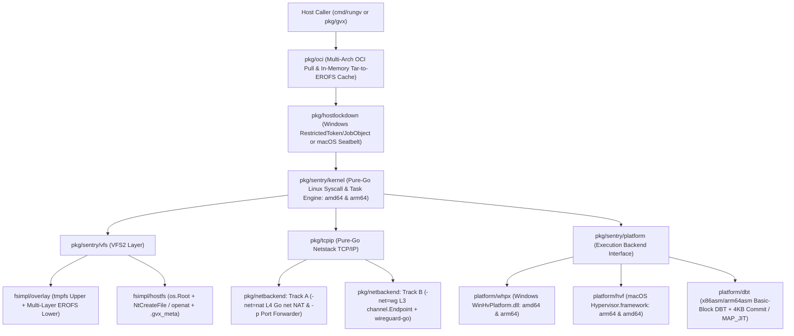
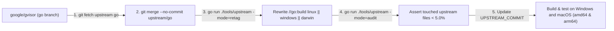
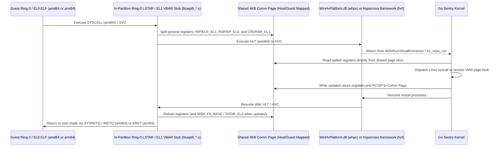
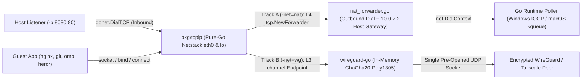
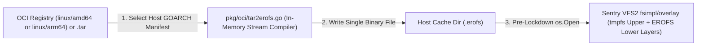
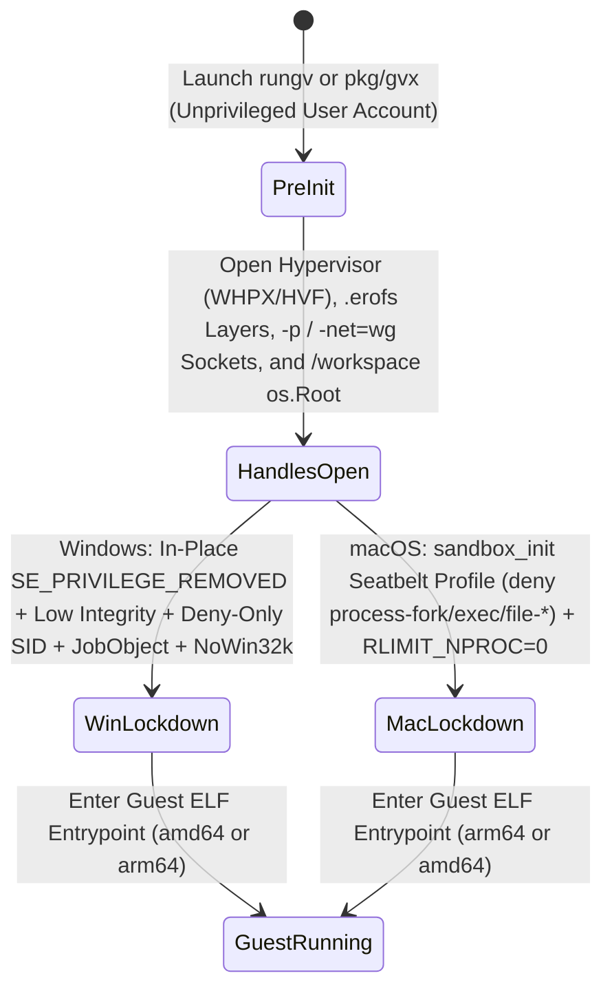

# `gvx` Architecture and Implementation Plan

`gvx` is an upstream-trackable fork of `google/gvisor` that ports the Sentry kernel to Windows (`windows/amd64`, `windows/arm64`) and macOS (`darwin/arm64`, `darwin/amd64`) as Priority-0 targets. Without booting a virtual machine, `gvx` runs Linux ELF64 binaries and OCI images inside one unprivileged process via `cmd/rungv` or `pkg/gvx`. The runtime intercepts Linux system calls in Go and translates them into native Windows NT, macOS XNU, Go `net`, and user-mode hypervisor calls.

---

## 1. Executive Summary and Architectural Scope

This section defines the Priority-0 target matrix, execution backends, networking modes, OCI image pipeline, and upstream isolation rules for `gvx`. Every subsystem implementation must satisfy these baseline contracts before merging.

| Design Objective | Engineering Contract | Verification Boundary |
| :--- | :--- | :--- |
| **Priority-0 Dual-OS & Dual-Arch** | Targets `windows/amd64`, `windows/arm64`, `darwin/arm64`, and `darwin/amd64` from one codebase. | Compiles and runs native `linux/amd64` and `linux/arm64` ELF64 workloads on Windows and macOS. |
| **Zero Runtime Elevation** | Runs under a standard user account and locks down the host process before guest entry. | Requires no UAC prompts, no `sudo`/`root`, no kernel drivers/kexts, and no background daemons. |
| **Hardware 4KB Paging (`whpx` & `hvf`)** | Uses `WinHvPlatform.dll` (Windows) and `Hypervisor.framework` (macOS) with 4KB Stage-2/EPT tables. | Bypasses the Windows 64KB `VirtualAlloc` limit and the Apple Silicon 16KB host page limit. |
| **Software DBT Fallback (`dbt`)** | Uses `golang.org/x/arch` decoders (`x86asm`, `arm64asm`), stencil emission, and 4KB commits / `MAP_JIT`. | Executes static and dynamic ELF64 binaries when hardware virtualization is disabled. |
| **Dual-Track Netstack (`pkg/netbackend`)** | Connects `pkg/tcpip` to an L4 Go `net` NAT and port forwarder (`-net=nat -p`) or an L3 `wireguard-go` tunnel (`-net=wg`). | Supports inbound/outbound port forwarding (`-p`) and `host.docker.internal`, or cryptographic L3 isolation. |
| **Direct OCI Image Execution (`pkg/oci`)** | Streams OCI `.tar.gz`/`.tar.zst` layers in memory into cached `<sha256>.erofs` images mounted via `fsimpl/overlay`. | Runs unmodified multi-arch Docker/OCI images without extracting Linux files onto NTFS or APFS. |
| **Clean Upstream Boundary** | Isolates host logic behind `_windows.go` and `_darwin.go` files and platform interfaces. | Modifies less than 5% of upstream gVisor and builds via `go build` on Go 1.25+. |



---

## 2. Repository Layout and Upstream Synchronization Architecture

`gvx` tracks the pre-generated `go` branch of `https://github.com/google/gvisor.git` (`upstream/go`). Upstream publishes `go_stateify` and `go_marshal` output for both `amd64` and `arm64` directly to `upstream/go`, so `gvx` compiles with `go build` without Bazel.

```text
gvx/ (Fork of google/gvisor@go)
 ├── AGENTS.md                              # [NEW] Mandatory agent instructions and ASD-STE100 gates
 ├── README.md                              # [NEW] Project overview, quickstart, and build guide
 ├── UPSTREAM_COMMIT                        # [NEW] Pinned commit SHA from google/gvisor (go branch)
 ├── docs/
 │   └── architecture.md                    # [NEW] Authoritative architecture and milestone plan
 ├── tools/
 │   └── upstream/                          # [NEW] Upstream sync, diff audit, and build-tag rewriter
 │       ├── main.go
 │       ├── buildtag_allowlist.txt
 │       └── diff_audit.go
 ├── cmd/
 │   └── rungv/                             # [NEW] Standalone Windows & macOS CLI runner (rungv)
 │       └── main.go
 ├── pkg/
 │   ├── gvx/                               # [NEW] Embeddable Go library API for host tools
 │   │   ├── sandbox.go
 │   │   └── config.go
 │   ├── oci/                               # [NEW] Multi-arch OCI puller and Tar-to-EROFS compiler
 │   │   ├── pull.go
 │   │   ├── tar2erofs.go
 │   │   └── cache.go
 │   ├── netbackend/                        # [NEW] Dual-track Netstack egress & port forwarder
 │   │   ├── nat_forwarder.go
 │   │   ├── port_forwarder.go
 │   │   └── wireguard_endpoint.go
 │   ├── sync/
 │   │   ├── futex_linux.go                 # Unmodified upstream Linux SYS_FUTEX implementation
 │   │   ├── futex_windows.go               # [NEW] WaitOnAddress / WakeByAddressSingle bindings
 │   │   └── futex_darwin.go                # [NEW] XNU __ulock_wait / __ulock_wake bindings
 │   ├── memutil/
 │   │   ├── memutil_linux.go               # Unmodified upstream memfd_create / mmap wrappers
 │   │   ├── memutil_windows.go             # [NEW] CreateFileMappingW + MapViewOfFile3 wrappers
 │   │   └── memutil_darwin.go              # [NEW] mmap(MAP_ANON) + mach_vm_remap wrappers
 │   ├── fd/
 │   │   ├── fd_windows.go                  # [NEW] Unified HostHandle wrapping Win32 HANDLE
 │   │   └── fd_darwin.go                   # [NEW] Unified HostHandle wrapping Darwin FD
 │   ├── hostlockdown/
 │   │   ├── lockdown_windows.go            # [NEW] RestrictedToken, Low Integrity, JobObject, Win32k block
 │   │   └── lockdown_darwin.go             # [NEW] Seatbelt sandbox_init SBPL profile & RLIMIT_NPROC=0
 │   └── sentry/
 │       ├── hostcpu/
 │       │   ├── hostcpu_windows.go         # [NEW] GetCurrentProcessorNumber binding
 │       │   └── hostcpu_darwin.go          # [NEW] Darwin CPU number binding
 │       ├── time/
 │       │   ├── calibrated_clock_windows.go # [NEW] QueryPerformanceCounter clock calibration
 │       │   └── calibrated_clock_darwin.go  # [NEW] mach_continuous_time clock calibration
 │       ├── pgalloc/
 │       │   ├── memory_file_windows.go     # [NEW] DiscardVirtualMemory / MEM_RESET page reclaim
 │       │   └── memory_file_darwin.go      # [NEW] madvise(MADV_FREE) page reclaim
 │       ├── platform/
 │       │   ├── whpx/                      # [NEW] Windows Hypervisor Platform backend (amd64 & arm64)
 │       │   │   ├── whpx.go
 │       │   │   ├── address_space.go
 │       │   │   ├── vcpu_amd64.go
 │       │   │   ├── vcpu_arm64.go
 │       │   │   ├── bluepill_amd64.s
 │       │   │   └── bluepill_arm64.s
 │       │   ├── hvf/                       # [NEW] macOS Hypervisor.framework backend (arm64 & amd64)
 │       │   │   ├── hvf.go
 │       │   │   ├── address_space.go
 │       │   │   ├── vcpu_arm64.go
 │       │   │   ├── vcpu_amd64.go
 │       │   │   ├── bluepill_arm64.s
 │       │   │   └── bluepill_amd64.s
 │       │   └── dbt/                       # [NEW] Fallback x86asm/arm64asm DBT backend (M5)
 │       │       ├── dbt.go
 │       │       ├── commit_mm_windows.go
 │       │       ├── commit_mm_darwin.go
 │       │       ├── dbt_decoder_amd64.go
 │       │       ├── dbt_decoder_arm64.go
 │       │       ├── sysv_to_host_amd64.s
 │       │       └── svc_to_host_arm64.s
 │       └── fsimpl/
 │           └── hostfs/                    # [NEW] Secure os.Root + .gvx_meta host mount (Windows & macOS)
 │               ├── hostfs.go
 │               ├── inode_windows.go
 │               ├── inode_darwin.go
 │               └── posix_rename_windows.go
 └── e2e/                                   # [NEW] Unified OS-agnostic end-to-end test suite
     └── sandbox_e2e_test.go
```

### 2.1 Layered Subsystem Map and Import Directionality

Each package owns one architectural boundary. Enforce top-down import directionality to keep Windows and macOS host APIs out of the pure-Go Sentry kernel.

| Package | Single Responsibility | Allowed Internal Imports | Forbidden Imports |
| :--- | :--- | :--- | :--- |
| `cmd/rungv` | Parses CLI flags (`run`, `pull`) and starts a sandbox instance. | `pkg/gvx`, `pkg/oci` | `pkg/sentry/*`, `WinHvPlatform.dll` |
| `pkg/gvx` | Coordinates `pkg/oci`, `pkg/netbackend`, `pkg/hostlockdown`, and Sentry boot. | `pkg/oci`, `pkg/netbackend`, `pkg/hostlockdown`, `pkg/sentry/*`, `pkg/fd`, `pkg/tcpip` | `cmd/*` |
| `pkg/oci` | Resolves `amd64`/`arm64` OCI manifests and compiles `.tar` layers into `.erofs` files. | `pkg/abi/linux` | `pkg/sentry/kernel`, `pkg/hostlockdown` |
| `pkg/netbackend` | Bridges `pkg/tcpip` to L4 Go `net` forwarders (`nat`) or L3 `wireguard-go` (`wg`). | `pkg/tcpip` | `pkg/sentry/kernel`, `WinHvPlatform.dll` |
| `pkg/hostlockdown` | Locks down the host process via Windows Tokens/JobObjects or macOS Seatbelt. | `golang.org/x/sys/windows`, `golang.org/x/sys/unix` | `pkg/sentry/*`, `pkg/tcpip` |
| `pkg/sentry/kernel` | Dispatches the OS-agnostic Linux task, signal, and syscall table (`amd64` & `arm64`). | `pkg/abi/linux`, `pkg/sentry/platform`, `pkg/sentry/vfs`, `pkg/sync` | `golang.org/x/sys/windows`, `pkg/hostlockdown` |
| `pkg/sentry/platform/whpx` | Executes guest Ring-3/EL0 code on Windows via `WinHvPlatform.dll` and 4KB EPT/Stage-2. | `pkg/sentry/platform`, `pkg/memutil`, `pkg/abi/linux`, `golang.org/x/sys/windows` | `pkg/sentry/kernel`, `pkg/sentry/vfs` |
| `pkg/sentry/platform/hvf` | Executes guest EL0/Ring-3 code on macOS via `Hypervisor.framework` and 4KB Stage-2/EPT. | `pkg/sentry/platform`, `pkg/memutil`, `pkg/abi/linux`, `golang.org/x/sys/unix` | `pkg/sentry/kernel`, `pkg/sentry/vfs` |
| `pkg/sentry/platform/dbt` | Executes guest code via `x86asm`/`arm64asm` Basic-Block DBT and 4KB commits / `MAP_JIT`. | `pkg/sentry/platform`, `pkg/memutil`, `pkg/abi/linux`, `golang.org/x/arch/*` | `pkg/sentry/kernel`, `pkg/sentry/platform/whpx` |
| `pkg/sentry/fsimpl/hostfs` | Mounts host `/workspace` via `os.Root`, `NtCreateFile`/`openat`, and `.gvx_meta`. | `pkg/sentry/vfs`, `pkg/abi/linux`, `pkg/fd`, `golang.org/x/sys/*` | `pkg/sentry/platform/*` |
| `pkg/sync`, `pkg/memutil`, `pkg/fd` | Provide host futexes, shared memory views, and host handles on Windows and macOS. | `golang.org/x/sys/windows`, `golang.org/x/sys/unix` | `pkg/sentry/*` |

### 2.2 Three-Tier Upstream Isolation Model (Descriptive Module)

To prevent merge conflicts during continuous upstream pulls, `gvx` partitions all repository files into three strict isolation tiers.

| Isolation Tier | File Paths | Upstream Conflict Rate | Maintenance Mechanism |
| :--- | :--- | ---: | :--- |
| **Tier 1: Additive Directories** | `cmd/rungv/`, `pkg/gvx/`, `pkg/oci/`, `pkg/netbackend/`, `pkg/hostlockdown/`, `pkg/sentry/platform/whpx/`, `pkg/sentry/platform/hvf/`, `pkg/sentry/platform/dbt/`, `pkg/sentry/fsimpl/hostfs/`, `e2e/`, `tools/upstream/`, `docs/` | `0.0%` | Owned exclusively by `gvx`; `upstream/go` never touches these paths. |
| **Tier 2: Sibling `_windows.go` & `_darwin.go` Files** | `pkg/sync/*_{windows,darwin}.go`, `pkg/memutil/*_{windows,darwin}.go`, `pkg/fd/*_{windows,darwin}.go`, `pkg/sentry/pgalloc/*_{windows,darwin}.go`, `pkg/sentry/time/*_{windows,darwin}.go`, `pkg/sentry/hostcpu/*_{windows,darwin}.go` | `0.0%` | Placed alongside unmodified `*_linux.go` files; Go selects the target file by `GOOS`. |
| **Tier 3: Build-Tag & Seam Patches** | Pure-Go files listed in `tools/upstream/buildtag_allowlist.txt` and `io_uring` `-ENOSYS` stubs | `< 5.0%` | Re-applied automatically by `tools/upstream` (`//go:build linux \|\| windows \|\| darwin`) after every `git merge upstream/go`. |



### 2.3 Upstream Diff and Synchronization Procedure (Procedural Module)

Run this procedure to audit the current upstream diff or merge new commits from `google/gvisor`.

> [!WARNING]
> Do not hand-edit `*_linux.go` files or scatter ad-hoc changes across pure-Go Sentry files. Unrecorded edits in Tier 3 files cause merge conflicts during upstream synchronization and violate the 5% diff ceiling. Register every build-tag change in `tools/upstream/buildtag_allowlist.txt`.

1. Register the upstream gVisor repository as the `upstream` Git remote.
2. Fetch the latest `go` branch from `upstream`.
3. Inspect the modified upstream file count and verify the `< 5.0%` budget against `UPSTREAM_COMMIT`.
4. Merge `upstream/go` without committing.
5. Run `tools/upstream` in `retag` mode to apply `//go:build linux || windows || darwin` to allowlisted files.
6. Run `tools/upstream` in `audit` mode to assert zero unauthorized edits in `*_linux.go` files.
7. Record the merged `upstream/go` SHA in `UPSTREAM_COMMIT` and verify all four Priority-0 targets.

```bash
git remote add upstream https://github.com/google/gvisor.git 2>/dev/null || true
git fetch upstream go

# Merge new upstream commits and re-apply build tags
git merge --no-commit upstream/go
go run ./tools/upstream -mode=retag
go run ./tools/upstream -mode=audit -max-ratio=0.05
git rev-parse upstream/go > UPSTREAM_COMMIT

# Verify all four Priority-0 host targets compile cleanly
GOOS=windows GOARCH=amd64 go build ./...
GOOS=windows GOARCH=arm64 go build ./...
GOOS=darwin  GOARCH=arm64 go build ./...
GOOS=darwin  GOARCH=amd64 go build ./...
```

---

## 3. Subsystem Porting Specifications

This section specifies the Windows and macOS APIs, `amd64` and `arm64` transitions, DBT decoders, network backends, OCI loaders, and security invariants for each subsystem.

### 3.1 Host OS Primitives and Build-Tag Decoupling (Descriptive Module)

Approximately 65% of gVisor (`pkg/sentry/kernel`, `pkg/sentry/arch`, `pkg/ring0`, `pkg/sentry/vfs`, `pkg/sentry/fsimpl/tmpfs`, `pkg/sentry/fsimpl/erofs`, `pkg/sentry/fsimpl/overlay`, and `pkg/tcpip`) contains OS-agnostic Go code supporting both `amd64` and `arm64`. `tools/upstream` expands the build tags on these pure-Go files to `//go:build linux || windows || darwin`, while `_windows.go` and `_darwin.go` files implement the host primitives.

| gVisor Package | Current Linux Dependency | Windows Implementation (`_windows.go`) | macOS Implementation (`_darwin.go`) |
| :--- | :--- | :--- | :--- |
| **`pkg/sync`** | `SYS_FUTEX` (`FUTEX_WAIT`, `FUTEX_WAKE`) | `WaitOnAddress`, `WakeByAddressSingle`, `WakeByAddressAll` (`api-ms-win-core-synch-l1-2-0.dll`). | `__ulock_wait` and `__ulock_wake` (`UL_COMPARE_AND_WAIT` in `libSystem.B.dylib`). |
| **`pkg/memutil` & `pgalloc`** | `memfd_create`, `SYS_MMAP`, `MADV_DONTNEED`, `FALLOC_FL_PUNCH_HOLE` | `CreateFileMappingW(INVALID_HANDLE_VALUE, ...)`, `MapViewOfFile3`, and `DiscardVirtualMemory` (`MEM_RESET`). | `mmap(MAP_ANON)`, `mach_vm_remap` (multi-view shared aliasing), and `madvise(MADV_FREE)`. |
| **`pkg/sentry/time` & `hostcpu`** | `clock_gettime(CLOCK_MONOTONIC)`, `getcpu` VDSO | `QueryPerformanceCounter` / `QueryPerformanceFrequency` and `GetCurrentProcessorNumber`. | `mach_continuous_time` / `clock_gettime_nsec_np` and `pthread_cpu_number_np`. |
| **`pkg/fd`** | Raw `int` FDs, `dup3`, `SCM_RIGHTS` | `HostHandle` wrapping `syscall.Handle` with explicit `Close()` ownership. | `HostHandle` wrapping Darwin file descriptors with `fcntl(F_DUPFD_CLOEXEC)`. |
| **`pkg/tcpip`** | `af_packet` / `tun` host links | Pure-Go Netstack routed via `pkg/netbackend` (`-net=nat` or `-net=wg`). | Pure-Go Netstack routed via `pkg/netbackend` (`-net=nat` or `-net=wg`). |
| **`pkg/abi/linux` & `sentry/arch`** | Pure Go (`amd64` & `arm64`) | Retain 100% unchanged; supports Linux `x86_64` and `aarch64` ABIs natively. | Retain 100% unchanged; supports Linux `aarch64` and `x86_64` ABIs natively. |
| **`pkg/sentry/syscalls`** | `io_uring` host passthrough | Return `-ENOSYS` on `io_uring_setup` and `io_uring_enter` to select Sentry `epoll`. | Return `-ENOSYS` on `io_uring_setup` and `io_uring_enter` to select Sentry `epoll`. |

### 3.2 Primary Hardware Hypervisor Engines: `platform/whpx` (Windows) and `platform/hvf` (macOS)

`platform/whpx` (Windows `WinHvPlatform.dll`) and `platform/hvf` (macOS `Hypervisor.framework`) share one architectural design across `amd64` and `arm64`. Both backends map 4KB guest physical pages from `pgalloc.MemoryFile`. Both also use an in-partition Ring-0 (`amd64`) or EL1 (`arm64`) shared communication page to avoid per-syscall register API calls.

| Hypervisor Operation | Windows (`platform/whpx` on `amd64` & `arm64`) | macOS (`platform/hvf` on `arm64` & `amd64`) |
| :--- | :--- | :--- |
| **Privilege / Signing Requirement** | Standard user token (zero admin or driver privileges). | Standard user token with ad-hoc `com.apple.security.hypervisor` signature (`codesign -s -`). |
| **Partition Creation** | `WHvCreatePartition` + `WHvSetupPartition` | `hv_vm_create(NULL)` |
| **4KB Page Granularity Mapping** | `WHvMapGpaRange` (bypasses Windows 64KB `VirtualAlloc` granularity). | `hv_vm_map` with 4KB guest `TCR_EL1.TG0` (bypasses Apple Silicon 16KB host page granularity). |
| **vCPU Execution Call** | `WHvRunVirtualProcessor(partition, vpIndex, ...)` | `hv_vcpu_run(vcpu)` |
| **Async Signal Preemption** | `WHvCancelRunVirtualProcessor(partition, vpIndex, 0)` | `hv_vcpus_exit(&vcpu, 1)` |
| **`amd64` Syscall Trap (`bluepill_amd64.s`)** | Ring-3 `SYSCALL` enters Ring-0 `MSR_LSTAR`, spills registers to Comm Page, executes `HLT`. | Ring-3 `SYSCALL` enters Ring-0 `MSR_LSTAR`, spills registers to Comm Page, executes `HLT` / `VMCALL`. |
| **`arm64` Syscall Trap (`bluepill_arm64.s`)** | EL0 `SVC #0` enters EL1 `VBAR_EL1`, spills `X0..X8, SP_EL0, ELR_EL1, TPIDR_EL0` to Comm Page, executes `HVC #0`. | EL0 `SVC #0` enters EL1 `VBAR_EL1`, spills `X0..X8, SP_EL0, ELR_EL1, TPIDR_EL0` to Comm Page, executes `HVC #0`. |



#### Partition Initialization and Shared-Page Execution (Descriptive Module)

During vCPU initialization, `whpx` and `hvf` map a minimal Ring-0 (`amd64` GDT, IDT, `MSR_LSTAR`) or EL1 (`arm64` `VBAR_EL1`, 4KB `TCR_EL1`) kernel environment. They also map a 4KB shared communication page into the partition. On `SYSCALL`, `SVC #0`, or a page fault, the in-partition stub writes active registers to the shared page and executes `HLT` or `HVC #0`.

The Go Sentry thread reads the spilled registers from the shared page, services the syscall or VMA fault, updates the page, and resumes the vCPU. For asynchronous Linux signals (`SIGINT`, `SIGKILL`), `Interrupt()` sets an atomic `PendingInterrupt` flag in the shared page. It then calls `WHvCancelRunVirtualProcessor` (Windows) or `hv_vcpus_exit` (macOS). Checking `PendingInterrupt` before each VM entry prevents lost wakeups.

### 3.3 Fallback DBT Engine: `pkg/sentry/platform/dbt` (M5)

`platform/dbt` executes Linux ELF64 binaries on corporate endpoints or nested cloud VMs where `WinHvPlatform.dll` or `Hypervisor.framework` is unavailable. It supports both `amd64` and `arm64` across Windows and macOS.

#### Memory Slicing and Arena Fault Handling (`commit_mm_windows.go`, `commit_mm_darwin.go`) (Descriptive Module)

On Windows (`commit_mm_windows.go`), the memory manager reserves a contiguous guest virtual address arena via `VirtualAlloc(..., MEM_RESERVE, PAGE_NOACCESS)`. It services 4KB fixed mappings (`mmap(MAP_FIXED)`) by committing individual 4KB pages via `VirtualAlloc(addr, 4096, MEM_COMMIT, PAGE_READWRITE)` and `VirtualProtect`. On macOS (`commit_mm_darwin.go`), the memory manager maps the guest arena via `mmap`. It allocates executable code caches via `mmap(..., MAP_ANON | MAP_JIT, ...)` toggled with `pthread_jit_write_protect_np`.

Both OS backends register an arena-scoped fault handler (`AddVectoredExceptionHandler` on Windows; Mach exception port / `SIGSEGV` handler on macOS) that inspects the faulting address first. If the address falls outside `[guestArenaBase, guestArenaEnd)`, the handler defers to the Go runtime immediately. For faults inside the guest arena, the handler services Copy-on-Write (`MAP_PRIVATE`), stack growth, or guest `SIGSEGV` delivery.

#### Single-Pass Basic-Block DBT Using `golang.org/x/arch` (`dbt_decoder_amd64.go`, `dbt_decoder_arm64.go`) (Descriptive Module)

Instead of a custom disassembler or `cmd/internal/obj`, `platform/dbt` uses the zero-allocation Go disassemblers (`golang.org/x/arch/x86/x86asm` and `arm64asm`) with byte-copy passthrough and compact stencils. Each basic block decodes once on cold miss (~20 nanoseconds per instruction) and runs from cached machine code, adding under 2 milliseconds of overhead.

| Architecture | Decoder Package | Copied Instructions | Rewritten Instructions & Register Protection |
| :--- | :--- | :--- | :--- |
| **`amd64` (`dbt_decoder_amd64.go`)** | `golang.org/x/arch/x86/x86asm` (`x86asm.Decode(src, 64)`) | Copies general instructions verbatim (`guestBytes[:inst.Len]`). | Rewrites `SYSCALL` (`0F 05`) into a jump to `sysv_to_host_amd64.s`, adjusts `RIP`-relative displacements, and rewrites `0x64` (`PrefixFS`) operands to `vCPU.GuestFSBase` to prevent Windows context-switch TLS truncation. |
| **`arm64` (`dbt_decoder_arm64.go`)** | `golang.org/x/arch/arm64/arm64asm` (`arm64asm.Decode(src)`) | Copies general 4-byte A64 instructions verbatim. | Rewrites `SVC #0` into a branch to `svc_to_host_arm64.s`, adjusts PC-relative `ADR`/`ADRP`/`LDR`, and rewrites guest `X18` accesses to `vCPU.GuestX18` to protect the reserved host `X18` register on Windows/macOS ARM64. |
| **Indirect Branches (`amd64` & `arm64`)** | Both decoders | None (terminates basic block). | Routes `RET`, `JMP reg`, and `BR Xn` through a per-thread direct-mapped hash table indexed by target guest PC. |

#### Hardware TLS and ABI Transition (`sysv_to_host_amd64.s`, `svc_to_host_arm64.s`) (Procedural Module)

Execute the guest-to-host context switch inside the assembly trampoline using this sequence:

> [!CAUTION]
> Do not call Go functions while `RSP`/`SP` points to the guest stack or while platform-reserved registers (`FSBase`/`GSBase` on `amd64`, `X18` on `arm64`) hold guest values. Calling Go code with a guest stack pointer or altered platform register crashes the Go runtime during stack growth or garbage collection. Restore the host stack pointer, Go `g` register, and host platform registers inside the assembly trampoline before entering Go.

1. Spill all guest general-purpose registers and the guest stack pointer (`RSP` or `SP`) into the `vCPU` struct.
2. Save the active guest TLS pointer (`rdfsbase` on `amd64` or `MRS TPIDR_EL0` on `arm64`) into `vCPU.GuestTLS`.
3. Restore the host `FSBase` (`wrfsbase` on `amd64`), host `X18` (`arm64`), host stack pointer, and Go `g` register.
4. Call the Sentry syscall dispatcher in Go.
5. Write `vCPU.GuestTLS` back to the guest TLS register (`wrfsbase` or `MSR TPIDR_EL0`).
6. Reload the guest general-purpose registers and jump to the translated Code Cache address for the target guest PC.

### 3.4 Dual-Track Netstack Backend and Port Forwarding: `pkg/netbackend`

Guest applications (`nginx`, `postgres`, `git`, `curl`, `omp`, `herdr`) invoke `socket()`, `connect()`, `bind()`, and `epoll_wait()` against gVisor's pure-Go `pkg/tcpip` (Netstack). Netstack implements the virtual Linux network interface (`eth0`), loopback (`lo`), TCP 3-way handshakes, sliding windows, and packet retransmission in memory. `pkg/netbackend` is 100% OS-agnostic Go code and runs identically on Windows and macOS.

| Egress Attribute | Track A: Go `net` NAT & Port Forwarder (`-net=nat`, Default) | Track B: In-Memory WireGuard (`-net=wg`) |
| :--- | :--- | :--- |
| **Interception Layer** | L4 Transport Layer (`tcp.NewForwarder`, `udp.NewForwarder`, `gonet.DialTCP`) | L3 Network Layer (`channel.Endpoint` to `wireguard-go`) |
| **Packet / Stream Path** | Dials outbound via host `net.DialContext` and forwards inbound `-p host:guest` listeners via `gonet.DialTCP`. | Encrypts raw IP packets in memory and transmits via one pre-bound host UDP socket. |
| **Admin / Driver Needed** | None (Standard unprivileged host sockets on Windows IOCP and macOS `kqueue`) | None (Pure in-memory link; no `WinTun.dll` or `/dev/tun`) |
| **Local / LAN Access** | Permitted by default (maps `10.0.2.2` / `host.docker.internal` to host `127.0.0.1`; optional `-isolate-lan` flag). | Enforced cryptographically; packets exit only through the WireGuard tunnel. |
| **Primary Workload** | Unmodified OCI containers (`-p 8080:80`), local dev tools (`git`, `omp`), and L4/L7 API key proxies. | Enterprise LAN isolation, multi-sandbox mesh, and remote `herdr` cluster links. |



#### Track A: L4 Go `net` Forwarder and Bidirectional Port Forwarding (`nat_forwarder.go`, `port_forwarder.go`) (Descriptive Module)

In `-net=nat` mode, `nat_forwarder.go` registers `tcp.NewForwarder` and `udp.NewForwarder` handlers on the Netstack instance. When a guest process connects to an external address or local LAN host, Netstack completes the virtual TCP handshake and invokes the forwarder callback. Outbound connections to `10.0.2.2` (`host.docker.internal`) route to the host loopback (`127.0.0.1`). Guest `127.0.0.1` traffic remains isolated on the container's internal `lo` interface. Callers can pass the optional `-isolate-lan` flag when they wish to block RFC1918 and host loopback ranges.

For inbound port forwarding (`-p hostPort:guestPort`), `port_forwarder.go` binds host `net.Listener` and `net.PacketConn` sockets before `hostlockdown.Apply()` executes. When a host client connects to a published port (`127.0.0.1:8080`), `port_forwarder.go` calls `gonet.DialTCP` into Netstack (`10.0.2.15:80`) and relays both streams. Go's `internal/poll` runtime multiplexes host sockets over Windows IOCP and macOS `kqueue` without custom C socket loops. Optional L4/L7 stream interceptors attach at the outbound forwarder boundary to inject host-held LLM API keys without exposing secrets inside the guest environment.

#### Track B: L3 In-Memory WireGuard Tunnel (`wireguard_endpoint.go`) (Descriptive Module)

In `-net=wg` mode, `wireguard_endpoint.go` attaches a Netstack `channel.Endpoint` (MTU 1420) directly to `golang.zx2c4.com/wireguard/device` in Go memory. Before `hostlockdown.Apply()` locks down the process, `wireguard_endpoint.go` opens one host UDP socket (`net.ListenPacket("udp", ":0")`) and passes it to the WireGuard bind interface. Outbound guest IP packets enter `wireguard-go` in memory for ChaCha20-Poly1305 encryption. Encrypted packets exit exclusively through that pre-bound UDP socket to the configured WireGuard or Tailscale peer.

### 3.5 Unmodified Multi-Arch OCI Image Runner: `pkg/oci`

Extracting Linux container layers (`.tar.gz`) directly onto Windows NTFS or case-insensitive macOS APFS breaks case-sensitive filenames (`xt_CONNMARK.h` vs. `xt_connmark.h`), fails on reserved Windows names (`CON`, `AUX`, `NUL`, `:`), discards POSIX `uid/gid` ownership, and requires elevated privileges for device nodes or symbolic links. `pkg/oci` runs unmodified OCI and Docker images on both Windows and macOS by compiling layer tarballs in memory into cached EROFS images.



#### Tar-to-EROFS Layer Compilation and Overlay Mount (Procedural Module)

Execute these steps in `pkg/oci` before calling `hostlockdown.Apply()`:

1. Resolve the OCI Image Index and select the manifest matching `linux/amd64` or `linux/arm64` for the target guest architecture.
2. Parse `Entrypoint`, `Cmd`, `Env`, `WorkingDir`, and `User` from the OCI image configuration JSON.
3. Stream each `.tar.gz` or `.tar.zst` layer in memory through `tar2erofs.go` without extracting files onto NTFS or APFS.
4. Convert OverlayFS whiteout markers (`.wh.<name>` and `.wh..wh..opq`) into native EROFS whiteout nodes and opaque directory attributes.
5. Write each compiled layer to the non-TCC cache directory (`%LOCALAPPDATA%\gvx\cache\layers\` on Windows; `~/Library/Caches/gvx/layers/` on macOS).
6. Open read-only `os.File` handles for all cached `.erofs` layers before calling `hostlockdown.Apply()`.
7. Mount the `.erofs` handles as ordered read-only lower layers under Sentry's `fsimpl/overlay` with `fsimpl/tmpfs` as the writable upper layer.

### 3.6 Secure Host File System Driver: `pkg/sentry/fsimpl/hostfs`

`fsimpl/hostfs` replaces `pkg/sentry/fsimpl/gofer` (`lisafs`) to mount the host `/workspace` directory on Windows and macOS without spawning an external file-server process.

#### Handle-Scoped Traversal and POSIX Adaptation (Descriptive Module)

`hostfs` anchors the workspace mount using Go 1.25+ `os.OpenRoot(hostWorkspacePath)` before sandbox lockdown. On Windows (`inode_windows.go`), every file open invokes `NtCreateFile` with `OBJECT_ATTRIBUTES.RootDirectory` pinned to the `os.Root` handle and enforces `FILE_OPEN_REPARSE_POINT`. On macOS (`inode_darwin.go`), `os.OpenRoot` uses `openat(dirfd, ..., O_NOFOLLOW | O_SYMLINK)` so the XNU kernel never traverses symbolic links or firmlinks pointing outside `/workspace`.

On Windows, `hostfs` sets `FILE_SHARE_READ | FILE_SHARE_WRITE | FILE_SHARE_DELETE` on every open. It implements `rename(2)` and `unlink(2)` on open files via `SetFileInformationByHandle(FileRenameInfoEx)` with `FILE_RENAME_FLAG_POSIX_SEMANTICS`. On macOS, `hostfs` uses native `renameat` and `unlinkat` scoped to directory file descriptors. On both platforms, an in-memory xattr table stores virtual POSIX mode bits (`0755`), `uid/gid`, and intra-workspace symlinks. It persists this table atomically to `.gvx_meta`.

### 3.7 Host Self-Lockdown and Security Model: `pkg/hostlockdown`

`gvx` enforces a three-ring defense-in-depth security model against untrusted guest code.

| Security Ring | Boundary Owner | Enforced Invariant |
| :--- | :--- | :--- |
| **Ring 1: Execution Boundary** | `platform/whpx`, `platform/hvf`, `platform/dbt` | Executes guest instructions inside 4KB EPT/Stage-2 tables or a DBT Code Cache with zero direct access to `ntdll.dll` or XNU syscalls. |
| **Ring 2: Application Kernel** | `pkg/sentry/kernel`, `fsimpl/hostfs`, `pkg/netbackend` | Services ~250 Linux syscalls in memory-safe Go and scopes all `/workspace` opens to the `os.Root` handle. |
| **Ring 3: Host OS Containment** | `pkg/hostlockdown` (Windows NT & macOS XNU) | Locks down the host process before guest entry so even a hypothetical Sentry compromise cannot spawn child processes or read/write unbound host files. |



#### Windows Lockdown Sequence (`lockdown_windows.go`) (Procedural Module)

Execute these steps in `lockdown_windows.go` before starting virtual processor execution:

> [!IMPORTANT]
> Open the WHPX partition handle, cached `.erofs` layer handles, `-p` host listeners, the `-net=wg` UDP socket, and `/workspace` `os.Root` before calling `hostlockdown.Apply()`. Once `hostlockdown.Apply()` locks down the process token and sets `JOB_OBJECT_LIMIT_ACTIVE_PROCESS = 1`, the Windows kernel rejects new host file opens and child processes.

1. Apply an inheritable Low-Integrity ACE (`S-1-16-4096`) to writable `/workspace` directories so Windows MIC permits guest writes after token downgrade.
2. Open the live primary process token (`OpenProcessToken`) and call `AdjustTokenPrivileges` with `SE_PRIVILEGE_REMOVED` to delete all privileges in-place.
3. Call `SetTokenInformation(hPrimaryToken, TokenIntegrityLevel, ...)` to lower the live primary token integrity level to `Low` (`S-1-16-4096`) in-place.
4. Create a `DISABLE_MAX_PRIVILEGE` restricted token with `SE_GROUP_USE_FOR_DENY_ONLY` and bind it to each vCPU thread via `SetThreadToken`.
5. Create an anonymous Job Object with `CreateJobObjectW` and assign the current process via `AssignProcessToJobObject`.
6. Set `JOB_OBJECT_LIMIT_ACTIVE_PROCESS = 1` and `JOB_OBJECT_LIMIT_DIE_ON_UNHANDLED_EXCEPTION` on the Job Object to block child process creation (`cmd.exe`, `powershell.exe`).
7. Set `JOB_OBJECT_UILIMIT_HANDLES | JOB_OBJECT_UILIMIT_READCLIPBOARD | JOB_OBJECT_UILIMIT_WRITECLIPBOARD` to isolate host UI handles and the clipboard.
8. Call `SetProcessMitigationPolicy(ProcessSystemCallDisablePolicy, ...)` with `DisallowWin32kSystemCalls = 1` to block `win32kfull.sys` system calls.

#### macOS Lockdown Sequence (`lockdown_darwin.go`) (Procedural Module)

Execute these steps in `lockdown_darwin.go` after opening the `Hypervisor.framework` VM, cached `.erofs` layer descriptors, network sockets, and `/workspace` `os.Root` descriptor:

1. Call `setrlimit(RLIMIT_NPROC, &rlimit{Cur: 0, Max: 0})` to block `fork()` at the XNU kernel boundary.
2. Call `sandbox_init_with_parameters` with the Seatbelt `deny default` profile to block `process-fork`, `process-exec*`, and new host file opens.

---

## 4. Milestone Roadmap and Verification Criteria

Implementation proceeds across five sequential milestones (`M1` through `M5`) targeting both Windows (`amd64`, `arm64`) and macOS (`arm64`, `amd64`) as Priority-0 platforms.

| Phase | Milestone | Key Deliverables | Verification Gate |
| :--- | :--- | :--- | :--- |
| **M1** | **Host Primitives & Pure-Go Sentry Compile** | `pkg/sync` (`WaitOnAddress` & `__ulock_wait`), `pkg/memutil` (`MapViewOfFile3` & `mach_vm_remap`), `pkg/fd`, `pgalloc`, `time`, `hostcpu`, `tools/upstream`, and Sentry build-tag expansion (`linux \|\| windows \|\| darwin`). | `go build ./pkg/sentry/kernel/...` and primitive unit tests pass on `windows/{amd64,arm64}` and `darwin/{arm64,amd64}`. |
| **M2** | **WHPX & HVF Engines & Static ELF Execution** | `pkg/sentry/platform/whpx` (Windows `amd64`/`arm64`), `pkg/sentry/platform/hvf` (macOS `arm64`/`amd64`), shared-page trampolines (`bluepill_amd64.s`, `bluepill_arm64.s`), `cmd/rungv`, and `pkg/gvx`. | Boot static `busybox` (`PID 1`) via `platform/whpx` on Windows and `platform/hvf` on macOS and execute commands at a `busybox ash` prompt. |
| **M3** | **Dynamic Linking, Dual-Track Netstack & OCI Runner** | `clone`, `futex`, signals, TLS (`ARCH_SET_FS` & `TPIDR_EL0`), VDSO, `pkg/netbackend` (`-net=nat -p` & `-net=wg`), and `pkg/oci` (multi-arch Tar-to-EROFS + `fsimpl/overlay`). | Run unmodified `alpine:3.20`, `nginx:alpine`, and `python:3.12-alpine` OCI images (`amd64` & `arm64`) on Windows and macOS. |
| **M4** | **`hostfs` VFS2 Driver & Self-Lockdown** | `pkg/sentry/fsimpl/hostfs` (`os.OpenRoot`, `NtCreateFile`/`openat`, `.gvx_meta`) and `pkg/hostlockdown` (Windows RestrictedToken/JobObject & macOS Seatbelt `sandbox_init`). | Pass POSIX rename/unlink torture tests (`git rebase`, `bun install`) on `/workspace`; verify subprocess creation fails on both Windows and macOS. |
| **M5** | **`dbt` Fallback Engine (DBT & 4KB Commit / `MAP_JIT`)** | `pkg/sentry/platform/dbt`: `commit_mm_{windows,darwin}.go`, `x86asm`/`arm64asm` Basic-Block DBT (`dbt_decoder_{amd64,arm64}.go`), `FS:` and `X18` rewriting, and assembly trampolines. | Execute static and dynamic `amd64` and `arm64` ELF64 binaries on Windows and macOS with hardware virtualization disabled. |

### 4.1 Host-Native-First Execution Order and Unified E2E Suite (Descriptive Module)

Within each milestone (`M1` through `M5`), engineers implement and verify `darwin/arm64` code paths (`*_darwin.go`, `*_arm64.s`, `platform/hvf`) first on the Apple Silicon development host. Running `go test -race ./...` natively on `darwin/arm64` validates the Sentry integration, VFS semantics, and OCI/Netstack pipelines immediately. Once `darwin/arm64` passes all tests, engineers implement the sibling `windows/{amd64,arm64}` (`*_windows.go`, `platform/whpx`) and `darwin/amd64` bindings and verify cross-compilation across all four targets.

`gvx` enforces the Barbell Testing Model across two test layers:

| Test Layer | Package Scope | Build Constraints | Behavioral Contract Verified |
| :--- | :--- | :--- | :--- |
| **Bottom of Barbell: Host Primitive Unit Tests** | `pkg/sync`, `pkg/memutil`, `pkg/fd`, `pkg/hostlockdown`, `platform/{whpx,hvf}` | OS-specific (`*_darwin_test.go`, `*_windows_test.go`) | Verifies low-level OS syscalls (`__ulock_wait`, `WaitOnAddress`, `mach_vm_remap`, `MapViewOfFile3`, Seatbelt, JobObjects) in isolation. |
| **Top of Barbell: Unified Black-Box E2E Suite** | `e2e/` (`sandbox_e2e_test.go`) | 100% OS-agnostic (`//go:build darwin \|\| windows`) | Invokes `pkg/gvx` and `cmd/rungv` with identical assertions across Windows and macOS (`amd64` & `arm64`) and all backends (`hvf`, `whpx`, `dbt`). |
