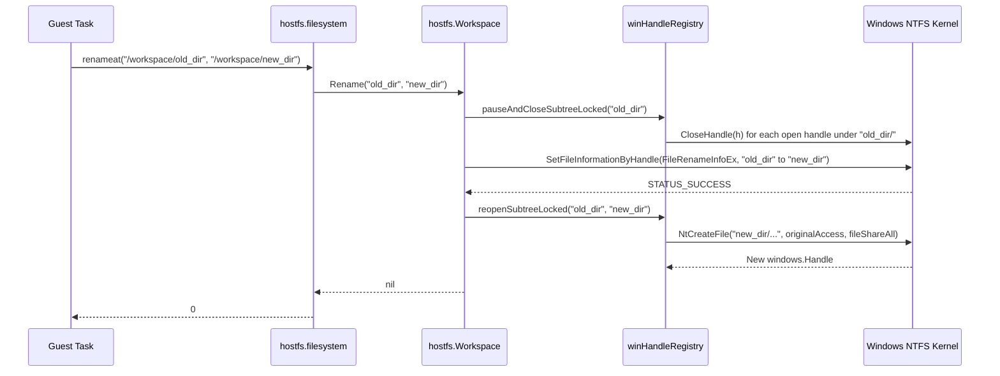
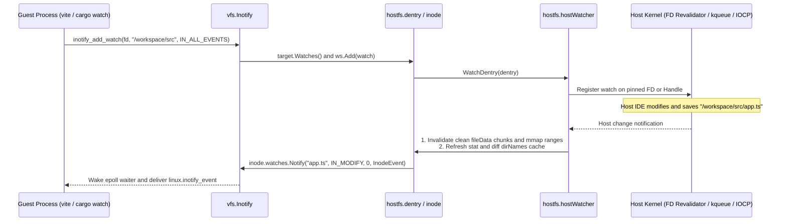

# GVXIP-001: Adaptive POSIX Translation and Host Event Bridge for `hostfs`

This specification defines the `hostfs` v2 architecture in `pkg/sentry/fsimpl/hostfs` and `pkg/gvx`. The design gives Linux guests complete POSIX semantics on directory bind mounts across Linux, macOS, and Windows hosts. On Linux hosts, `hostfs` passes operations directly to native kernel system calls without translation overhead. On macOS (`APFS`) and Windows (`NTFS`), `hostfs` activates targeted translation layers only for capabilities that the underlying volume lacks.

| Field | Value |
| :--- | :--- |
| **Document ID** | `GVXIP-001` |
| **Title** | Adaptive POSIX Translation and Host Event Bridge for `hostfs` |
| **Status** | Draft Specification |
| **Isolation Tier** | Tier 1 (`pkg/sentry/fsimpl/hostfs`, `pkg/gvx`, `pkg/hostlockdown`) |
| **Target Platforms** | `darwin/arm64`, `darwin/amd64`, `windows/amd64`, `windows/arm64`, `linux/amd64`, `linux/arm64` |
| **Companion Spec** | [`gvxip-002-ext4lite-volume-engine.md`](gvxip-002-ext4lite-volume-engine.md) |

---

## 1. Architectural Principles and Capability Probing

`hostfs` mounts a live host directory into the guest container. Host tools (IDEs, Git, file watchers) and guest Linux processes share these files in real time. The "gVisor Everywhere" principle imposes two strict invariants on `hostfs`. First, a guest Linux workload must observe identical POSIX behavior regardless of the host operating system. Second, a Linux host must execute native kernel operations without artificial limits or filename mangling from Windows or macOS rules.

`OpenWorkspace` in `pkg/sentry/fsimpl/hostfs/hostfs.go` probes the pinned `*os.Root` handle before `hostlockdown.Apply()` runs and records the volume capabilities in `WorkspaceCaps`.

```go
// WorkspaceCaps records the native capabilities of the mounted host volume.
type WorkspaceCaps struct {
	CaseSensitive     bool
	UnicodeNormalized bool
	RestrictsWinNames bool
	LocksOpenDirMove  bool
	NativeXattr       bool
	NativeRenameSwap  bool
	NativeFallocate   bool
}
```

### 1.1 Capability Detection Matrix

The capability probe runs once per workspace mount before sandbox lockdown. Each flag controls whether `hostfs` uses a direct host system call or activates a translation path.

| Capability Flag | Linux (`ext4` / `xfs`) | macOS (`APFS` Default) | macOS (`APFS` Case-Sensitive) | Windows (`NTFS` Default) | Windows (`NTFS` Per-Dir CS) |
| :--- | :--- | :--- | :--- | :--- | :--- |
| `CaseSensitive` | `true` | `false` | `true` | `false` | `true` |
| `UnicodeNormalized` | `false` | `true` (NFD) | `true` (NFD) | `false` | `false` |
| `RestrictsWinNames` | `false` | `false` | `false` | `true` | `true` |
| `LocksOpenDirMove` | `false` | `false` | `false` | `true` | `true` |
| `NativeXattr` | `true` (with fallback) | `false` (uses `.gvx_meta`) | `false` (uses `.gvx_meta`) | `false` (uses `.gvx_meta`) | `false` (uses `.gvx_meta`) |
| `NativeRenameSwap` | `true` (`RENAME_EXCHANGE`) | `true` (`RENAME_SWAP`) | `true` (`RENAME_SWAP`) | `false` (3-way swap) | `false` (3-way swap) |
| `NativeFallocate` | `true` (`fallocate`) | `true` (`F_PREALLOCATE`) | `true` (`F_PREALLOCATE`) | `true` (`FileAllocationInfo`) | `true` (`FileAllocationInfo`) |

---

## 2. Bidirectional Filename Codec and Normalization Bridge

Host directory mounts must keep ordinary filenames readable in host editors while accepting every valid POSIX filename from the guest. A valid POSIX filename can contain any byte except `/` (`0x2F`) and NUL (`0x00`). `hostfs` v2 translates filenames only when the host filesystem rejects a character, reserves a device name, normalizes Unicode bytes, or reports a case collision.

### 2.1 Unified Stateless `~gvx~` Prefix Codec

On Linux hosts (`RestrictsWinNames == false` and `CaseSensitive == true`), `NameCodec` is an identity function with zero allocation overhead. On Windows and case-insensitive volumes, `NameCodec` leaves 99.99% of filenames untouched. It applies a single stateless prefix grammar (`~gvx~` plus `%XX` hex bytes) to every escaped filename. Decoding (`ToGuest`) requires no `.gvx_meta` lookup: any host filename starting with `~gvx~` strips that prefix and unescapes `%XX` hex sequences.

- **Windows Reserved Device Names**: Windows rejects `CON`, `PRN`, `AUX`, `NUL`, `COM1` to `COM9`, and `LPT1` to `LPT9`, including filenames with extensions like `aux.c`. Prepending `~gvx~` changes the basename to `~gvx~aux.c`, which Windows accepts as a normal filename without `%XX` hex bytes.
- **Windows Forbidden Characters**: When `RestrictsWinNames` is `true`, `NameCodec` prepends `~gvx~` and encodes `: * ? " < > |`, control bytes, `%`, and trailing dots or spaces as `%XX`.
- **Case-Collision Coexistence**: When `CaseSensitive` is `false`, `hostfs` stores the first file in a directory unmangled (for example, `Readme.md`). When a second filename collides in case (`readme.md` or `README.md`), `NameCodec` prepends `~gvx~` and encodes uppercase letters as `%XX`. Because hex digits do not case-fold, any number of case permutations can coexist on APFS or NTFS without colliding.
- **Literal Prefix Escaping**: When a guest filename already starts with `~gvx~`, `NameCodec` prepends a second `~gvx~` and escapes `%` as `%25`. This rule preserves a strict 1:1 bijection.

| Guest Filename | Host Condition | Stored Host Disk Name | Decoded Guest Name (`ToGuest`) |
| :--- | :--- | :--- | :--- |
| `main.go` | Any host (normal file) | `main.go` | `main.go` |
| `aux.c` | `RestrictsWinNames == true` | `~gvx~aux.c` | `aux.c` |
| `Net::HTTP.3pm` | `RestrictsWinNames == true` | `~gvx~Net%3A%3AHTTP.3pm` | `Net::HTTP.3pm` |
| `Readme.md` (1st) | `CaseSensitive == false` | `Readme.md` | `Readme.md` |
| `readme.md` (2nd) | `CaseSensitive == false` (`Readme.md` exists) | `~gvx~readme.md` | `readme.md` |
| `README.md` (3rd) | `CaseSensitive == false` (`Readme.md` exists) | `~gvx~%52%45%41%44%4D%45.md` | `README.md` |
| `~gvx~literal` | Any non-Linux host | `~gvx~~gvx~literal` | `~gvx~literal` |

### 2.2 APFS Unicode Normalization Mapping

macOS APFS normalizes filenames to Unicode NFD on disk and matches both NFC and NFD forms in `fstatat`. However, `Workspace.exactNameLocked` compares raw guest bytes against the raw bytes returned by `readdirNames`. When a macOS user creates an NFD filename on the host, a Linux guest opening the NFC form receives `ENOENT` today.

When `UnicodeNormalized` is `true`, `dirNames` in `pkg/sentry/fsimpl/hostfs/hostfs.go` builds a secondary NFC lookup map alongside the exact byte map. If an exact byte match fails, `exactNameLocked` normalizes the guest name to NFC and resolves the corresponding `diskName`. It then passes `diskName` to `openat` or `fstatat`. `ReadDirChildren` and `getdents64` normalize unmangled host NFD names to NFC unless `.gvx_meta` records an explicit NFD guest name.

### 2.3 Host OS Clutter Filtering and Orphaned Entry Cleanup

Host desktop shells inject hidden metadata files into mounted directories. Finder creates `.DS_Store` and `._*` AppleDouble files on macOS, while Explorer creates `Thumbs.db` on Windows. In addition, external host deletions or killed sandbox sessions can leave orphaned records in `.gvx_meta` or leftover `.~gvx~tmp.*` files on disk.

`hostfs` v2 isolates the guest from host shell clutter and reclaims orphaned state through four rules:
- **Host Clutter Hiding**: Unless `.gvx_meta` owns the entry, `listDir`, `lookupLocked`, and `hostWatcher` ignore `.DS_Store` on macOS and `Thumbs.db` on Windows. They also ignore `._*` files on macOS only when the file is `<= 64 KiB` and starts with the 4-byte AppleDouble magic `0x00051607`. Filtering these names in `hostWatcher` prevents Finder or Explorer folder clicks from triggering guest `inotify` rebuilds.
- **Auto-Purge on `rmdir`**: When a guest calls `rmdir` on a directory with zero guest-visible entries, `Workspace.rmdir` unlinks any verified host clutter files first. It then calls `w.host.rmdir`, preventing spurious `ENOTEMPTY` failures during `rm -rf`.
- **Ephemeral File Sweep**: During `OpenWorkspace`, `hostfs` unlinks any leftover `~gvx~tmp.*` (`O_TMPFILE`) and `~gvx~swap.*` (`RENAME_EXCHANGE`) files left behind by a previously terminated process.
- **`.gvx_meta` Orphan Pruning**: During `loadMeta` and before flushing `.gvx_meta`, `Workspace` removes non-virtual records whose host files no longer exist on disk. It also removes virtual symlinks whose parent directories no longer exist.

---

## 3. Windows Open-Handle Quiescing for Directory Rename

On Windows NTFS, `SetFileInformationByHandle` with `FileRenameInfoEx` fails with `STATUS_ACCESS_DENIED` (`linuxerr.EACCES`) whenever any descendant file has an open `windows.Handle`. In `hostfs`, `regularFD` and `fileData.mh` hold `windows.Handle` values open across the lifetime of guest file descriptions and memory mappings.

To satisfy POSIX directory rename semantics on Windows (`LocksOpenDirMove == true`), `Workspace` maintains a registry of open descendant handles (`winHandleRegistry`). During a directory rename, `Workspace` closes open descendant handles under a write lock, renames the directory, and reopens the handles at their new paths.



### 3.1 Directory Rename Quiesce Procedure

Execute this procedure inside `Workspace.Rename` on Windows when the source entry is a directory and `LocksOpenDirMove` is `true`.

> [!CAUTION]
> Hold both `Workspace.mu` (write lock) and each affected `hostHandle.mu` before closing any `windows.Handle`. Releasing `hostHandle.mu` while the descriptor is closed causes concurrent `PRead` or `PWrite` calls to read an invalid handle.

1. Acquire the write lock on `Workspace.mu`.
2. Find all active `hostHandle` instances in `winHandleRegistry` with the prefix `oldRel + "/"`.
3. Acquire `h.mu.Lock()` on each matched `hostHandle` in lexical path order and record its original `hostID`.
4. Flush dirty mapped pages via `inode.data.flushRange` for each matched handle.
5. Call `CloseHandle` on the underlying `*os.File` of each matched `hostHandle`.
6. Call `w.host.rename(oldRel, newRel)` via `SetFileInformationByHandle`.
7. Reopen each matched `hostHandle` by `FILE_OPEN_BY_FILE_ID` or via `openAt` at `newRel`, and verify that its `hostID` matches step 3.
8. If step 6 fails, reopen each handle at its original `oldRel` path and verify its `hostID` before returning the error.
9. Release `h.mu.Unlock()` on all matched handles and release `Workspace.mu`.

```go
// winHandleRegistry tracks open regular-file handles on Windows so directory
// renames can quiesce and reopen descendant handles atomically.
type winHandleRegistry struct {
	mu      sync.Mutex
	handles map[*hostHandle]struct{}
}
```

---

## 4. Virtual Symlinks, Special Files, and Extended VFS2 Operations

Container workloads such as `python -m venv`, `npm install`, `cargo build`, `pytest`, and PostgreSQL use features beyond regular files. They require symlinks with absolute targets, UNIX domain sockets (`AF_UNIX`), named pipes (`FIFO`), extended attributes (`xattr`), and atomic file exchanges.

### 4.1 Unrestricted Virtual Symlink Targets

`validateSymlinkTarget` in `pkg/sentry/fsimpl/hostfs/hostfs.go` currently rejects symlinks with absolute targets (such as `/usr/bin/python3`). It also rejects relative `..` targets that ascend above the workspace root. This check breaks virtual environments and package managers inside `/workspace`.

Path traversal security in `hostfs` does not depend on restricting symlink target strings at creation time. Every host path walk in `walkParent` (`inode_unix.go` and `inode_windows.go`) enforces `O_NOFOLLOW` or `FILE_OPEN_REPARSE_POINT`, so the host kernel never dereferences a symlink inside `/workspace`. Instead, `dentry.ReadlinkAt` returns the target string to the Sentry VFS2 router, which resolves the target inside the guest mount namespace.

`hostfs` v2 replaces `validateSymlinkTarget` on guest-created symlinks with two security rules:
- **Virtual-Only Guest Symlinks**: `Workspace.symlink` stores every guest-created symlink exclusively in `.gvx_meta` (`POSIXAttr.Symlink`) and never creates a native OS symlink on the host disk. Reject only empty targets (`""`) with `linuxerr.ENOENT` and targets containing NUL bytes (`\x00`) with `linuxerr.EINVAL`. Virtual storage supports absolute targets (like `/usr/bin/python3`) inside the guest VFS2 namespace while preventing host Confused-Deputy attacks.
- **Host Symlink Confinement**: Pre-existing native symlinks created on the host disk remain subject to `validateSymlinkTarget` during `listDir` and `lookupLocked`. Any host symlink that points outside the workspace root remains hidden from the guest.

### 4.2 In-Memory UNIX Domain Sockets, FIFOs, and Extended Attributes

Host filesystems on Windows and macOS either lack native UNIX domain sockets and FIFOs or block them under Seatbelt and Low-Integrity tokens. Because guest IPC occurs entirely inside the Sentry kernel, `hostfs` v2 implements sockets and FIFOs in memory while persisting their directory entries on disk.

- **`AF_UNIX` Sockets (`MknodAt` with `S_IFSOCK`, `BoundEndpointAt`, `ConnectAt`)**: Create a 0-byte placeholder file on the host disk so directory listings and existence checks remain consistent. Record `Mode: S_IFSOCK | perm` in `.gvx_meta`. Store the active `transport.BoundEndpoint` on `hostfs.inode` in memory, matching `pkg/sentry/fsimpl/tmpfs/socket_file.go`.
- **Named Pipes (`MknodAt` with `S_IFIFO`)**: Create a 0-byte placeholder file on the host disk and record `Mode: S_IFIFO | perm` in `.gvx_meta`. Attach an in-memory `pipe.VFSPipe` to `hostfs.inode` so guest readers and writers communicate through Sentry memory.
- **Extended Attributes (`GetXattrAt`, `SetXattrAt`, `ListXattrAt`, `RemoveXattrAt`)**: On Linux hosts (`NativeXattr == true`), invoke `unix.Fgetxattr`, `unix.Fsetxattr`, `unix.Flistxattr`, and `unix.Fremovexattr` on the pinned descriptor. When the host returns `EPERM` or `EOPNOTSUPP`, or on macOS and Windows, store the attribute in `POSIXAttr.Xattrs` inside `.gvx_meta`. Enforce a 4 KiB total `xattr` size cap per inode (`linuxerr.ENOSPC`) and a 262,144-entry cap on `Workspace.meta` to prevent host memory exhaustion.

### 4.3 Extended VFS2 Operations Matrix

The table below defines the implementation contract for the remaining VFS2 operations across Linux, macOS, and Windows hosts.

| Operation / Feature | VFS2 Method | Linux Host Implementation | macOS Host Implementation | Windows Host Implementation |
| :--- | :--- | :--- | :--- | :--- |
| **Atomic Exchange** (`RENAME_EXCHANGE`) | `RenameAt` | `unix.Renameat2` with `RENAME_EXCHANGE` | `renamex_np` with `RENAME_SWAP` | 3-way rename via `~gvx~swap.<id>` under `Workspace.mu` |
| **Whiteout Rename** (`RENAME_WHITEOUT`) | `RenameAt` | Emulated under `Workspace.mu`: move source, create `.gvx_meta` char device `(0,0)` | Same as Linux | Same as Linux |
| **Space Preallocation** (`fallocate`) | `regularFD.Allocate` | `unix.Fallocate(fd, mode, off, len)` | `fcntl(F_PREALLOCATE)` plus `ftruncate` | `SetFileInformationByHandle(FileAllocationInfo)` |
| **Unnamed Temp File** (`O_TMPFILE`) | `OpenAt` | Native `O_TMPFILE` with fallback to unlinked `~gvx~tmp.<id>` | Create `~gvx~tmp.<id>`, mark `inode.unlinked = true`, unlink on `Release` | Create `~gvx~tmp.<id>` with `FILE_SHARE_DELETE`, unlink on `Release` |
| **Unlinked Open File `st_nlink`** | `regularFD.Stat` | Native kernel `fstat` (`st_nlink == 0`) | Native kernel `fstat` (`st_nlink == 0`) | Decrement reported `Nlink` to `0` when `inode.unlinked` is `true` |
| **Executable Busy Check** (`ETXTBSY`) | `OpenAt`, `SetStatAt`, `ConfigureMMap` | Embed `vfs.WriteCounter` in `hostfs.inode` | Embed `vfs.WriteCounter` in `hostfs.inode` | Embed `vfs.WriteCounter` in `hostfs.inode` |
| **Volume Space Reporting** | `StatFSAt`, `regularFD.StatFS` | `unix.Fstatfs` on `rootFD` | `unix.Fstatfs` on `rootFD` | `GetDiskFreeSpaceExW` on `rootHandle` |
| **Single-File Bind Mount** | `OpenWorkspace` | Pin parent directory and target filename; mount `regularFile` root dentry | Same as Linux | Same as Linux |

---

## 5. On-Demand Host-to-Guest File Event Bridge (`fswatch` / `inotify`)

Development tools inside a container (`vite`, `webpack`, `cargo watch`, `pytest-watch`, `tail -f`, `fswatch`) register Linux `inotify` watches on `/workspace` directories and files. In the current implementation (`pkg/sentry/fsimpl/hostfs/vfs.go`), `inode.watches.Notify` fires only when a guest task performs a VFS system call. Host edits (such as saving a file in VS Code) produce zero guest `inotify` events. They also leave stale 1 MiB data chunks in `fileData` (`pkg/sentry/fsimpl/hostfs/regular_file.go`).

`hostfs` v2 introduces an on-demand `hostWatcher` subsystem. `hostWatcher` does not watch the entire `/workspace` tree at startup. Instead, it attaches a host OS watch only when a guest `inotify` instance adds the first watch to `dentry.Watches()`. It detaches the host watch when `dentry.OnZeroWatches` runs.



### 5.1 Lockdown-Compliant Host Watcher Backends

Every host watcher backend must operate after `hostlockdown.Apply()` without spawning child processes, calling Mach services, or opening unbound paths. `hostWatcher` caps active watched dentries at `8,192` per workspace (`linuxerr.ENOSPC` when exceeded) to prevent host descriptor exhaustion.

| Host Platform | Kernel Primitive | Lockdown Compliance Mechanism (`pkg/hostlockdown`) | Event Translation to Linux `inotify` |
| :--- | :--- | :--- | :--- |
| **Linux** (`linux/{amd64,arm64}`) | FD-scoped `fstatat` (`AT_SYMLINK_NOFOLLOW`) and `getdents64` on watched dentries | `inotify_add_watch` takes a raw path pointer that seccomp cannot constrain to `/workspace`. Instead, when `activeWatches > 0`, `hostWatcher` revalidates only the watched `dentry` descriptors every `200ms` using `fstatat` and `getdents64`, which `hostFilesystemFilters()` already permits. Zero new syscalls enter the seccomp allowlist. | Diffs `(name, ino, mtime, ctime)` on watched directories and files to emit `IN_CREATE`, `IN_DELETE`, `IN_MODIFY`, `IN_ATTRIB`, and `IN_MOVED_FROM` plus `IN_MOVED_TO` paired by `ino`. |
| **macOS** (`darwin/{arm64,amd64}`) | `kqueue` and `kevent` (`EVFILT_VNODE`) | High-level `FSEvents` requires Mach IPC to `com.apple.FSEvents`, which Seatbelt `(deny default)` blocks. `EVFILT_VNODE` registers directly on file descriptors opened via `openat` inside the permitted `/workspace` subpath. Seatbelt already permits `kqueue` and `kevent`. | File FDs map `NOTE_WRITE\|NOTE_EXTEND` to `IN_MODIFY` and `NOTE_ATTRIB` to `IN_ATTRIB`. Directory FDs receive `NOTE_WRITE` on any child mutation; `hostWatcher` diffs `readdirNames` (with `(name, ino)` pairs) against `inode.dirNames` to synthesize `IN_CREATE`, `IN_DELETE`, and `IN_MOVED_FROM` plus `IN_MOVED_TO` (paired by matching `ino`). |
| **Windows** (`windows/{amd64,arm64}`) | `ReadDirectoryChangesW` (Overlapped IOCP) | `lockdown_windows.go` grants Low-Integrity and Logon SID access to the workspace tree. `hostWatcher` opens watched directories via `openAt` with `FILE_LIST_DIRECTORY` and posts overlapped `ReadDirectoryChangesW` buffers to the Go runtime IOCP poller. | `FILE_ACTION_ADDED` maps to `IN_CREATE`, `FILE_ACTION_REMOVED` maps to `IN_DELETE`, `FILE_ACTION_MODIFIED` maps to `IN_MODIFY\|IN_ATTRIB`, and `FILE_ACTION_RENAMED_OLD_NAME` plus `FILE_ACTION_RENAMED_NEW_NAME` map to `IN_MOVED_FROM` and `IN_MOVED_TO` with a shared `uniqueid.InotifyCookie`. |

### 5.2 Echo Suppression and Page-Cache Coherency Procedure

When a guest writes or renames a file, the VFS method in `pkg/sentry/fsimpl/hostfs/vfs.go` immediately notifies `inode.watches`. The host OS also emits a watcher event milliseconds later. Follow this procedure in `hostWatcher` to prevent duplicate events and stale page-cache reads.

> [!WARNING]
> Do not retain clean 1 MiB chunks in `fileData` when the host file size or modification timestamp changes outside a guest write. Retaining stale chunks causes guest `read` and `mmap` callers to observe outdated file contents after a host editor save.

1. Record the resulting host `(mtime, size)` snapshot on `inode` after every guest mutation (`PWrite`, `CreateAt`, `UnlinkAt`, `RenameAt`, `SetStatAt`).
2. Read the next batch of host notifications from the FD revalidator, `kqueue`, or `ReadDirectoryChangesW`.
3. Decode the host filename through `NameCodec.ToGuest` to recover the unmangled guest filename.
4. Compare the current host `fstat` `(mtime, size)` of the affected child against the last guest-recorded `(mtime, size)` snapshot.
5. Suppress the `IN_MODIFY` or `IN_ATTRIB` notification if the host `(mtime, size)` matches the state produced by the guest mutation.
6. Call `inode.data.invalidateCleanChunks()` and `inode.data.mappings.InvalidateAll()` when an external host modification changed `(mtime, size)`.
7. Update `Workspace.nameCache` for the watched directory and dispatch the translated event via `inode.watches.Notify`.

---

## 6. Metadata Schema v2 and Durability Contract

`hostfs` stores POSIX metadata in `.gvx_meta` at the workspace root. Ordinary metadata mutations (`chmod`, `chown`, `symlink`, `setxattr`) update `Workspace.meta` in memory and trigger a background coalesced write every `250ms` (`defaultCoalesceWindow`). Guest databases and applications require strict durability when they call `fsync`, `fdatasync`, `sync`, or write with `O_SYNC` or `O_DSYNC`. On those calls, `regularFD.Sync` and `directoryFD.Sync` bypass the coalesce timer. They synchronously flush dirty mapped pages (`inode.data.syncData`), the host file (`fd.h.sync`), `.gvx_meta` (`ws.Sync`), and the parent directory (`ws.syncDir`).

```go
// POSIXAttr holds the persisted POSIX metadata of one workspace-relative entry
// in .gvx_meta (schema version 2).
type POSIXAttr struct {
	Mode    uint32            `json:"mode"`
	UID     uint32            `json:"uid"`
	GID     uint32            `json:"gid"`
	Symlink string            `json:"symlink,omitempty"`
	Xattrs  map[string][]byte `json:"xattrs,omitempty"`
	Atime   int64             `json:"atime,omitempty"`
	Mtime   int64             `json:"mtime,omitempty"`
	Ctime   int64             `json:"ctime,omitempty"`
}
```
