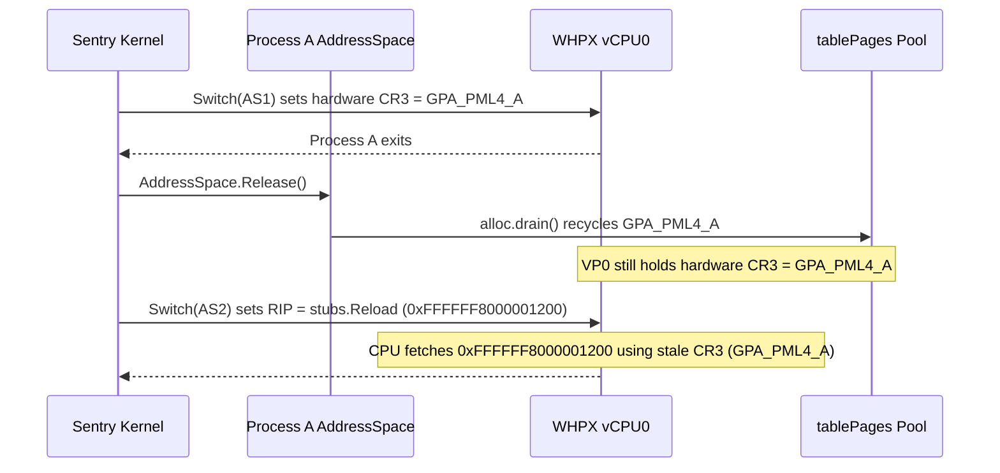

# GVXIP-003: Cross-Platform Execution Engine Stability, Compatibility, and Fast-Path Architecture

This specification defines the engineering work order for four core subsystems in `gvx`: `pkg/sentry/platform/whpx`, `pkg/sentry/fsimpl/hostfs`, `pkg/sentry/platform/systrap` (`darwinsystrap` and `winsystrap`), and the `darwinsystrap` 16KB and `ET_EXEC` compatibility layers. It identifies the exact source-level root causes of current crashes and performance bottlenecks, specifies the target memory and state-machine contracts, and provides a step-by-step execution plan for implementation agents.

| Field | Value |
| :--- | :--- |
| **Document ID** | `GVXIP-003` |
| **Title** | Cross-Platform Execution Engine Stability, Compatibility, and Fast-Path Architecture |
| **Status** | Active Specification and Work Order |
| **Isolation Tier** | Tier 1 (`pkg/sentry/platform/whpx`, `pkg/sentry/fsimpl/hostfs`, `e2e`) and Tier 2 (`pkg/sentry/platform/systrap/*_{darwin,windows}.go`) |
| **Target Platforms** | `darwin/arm64`, `darwin/amd64`, `windows/amd64`, `windows/arm64`, `linux/amd64`, `linux/arm64` |
| **Companion Specs** | [`gvxip-001-better-posix-hostfs.md`](gvxip-001-better-posix-hostfs.md), [`gvxip-002-ext4lite-volume-engine.md`](gvxip-002-ext4lite-volume-engine.md) |

---

## 1. Executive Summary and Work Order Track Matrix

`gvx` runs identical Linux container workloads across Windows (`whpx`, `winsystrap`), macOS (`hvf`, `darwinsystrap`), and Linux (`systrap`). Recent end-to-end benchmarks and multi-process compiler workloads (`alpine gcc`, `git`, `bun`, and `herdr`) exposed four architectural gaps across those backends. This specification organizes all required fixes into four independent tracks with falsifiable acceptance gates.

| Track | Subsystem and Files | Primary Symptom or Bottleneck | Target Architectural Fix | Acceptance Gate |
| :--- | :--- | :--- | :--- | :--- |
| **Track 1** | `pkg/sentry/platform/whpx` (`vcpu_amd64.go`, `vcpu_arm64.go`, `context.go`, `address_space.go`) | Multi-process `alpine gcc` crashes with `whpx: exit reason 0x4` (`x64ExitUnrecoverable` / Triple Fault). | Write `CR3` / `TTBR0` via host `WHvSetVirtualProcessorRegisters` in `prepareRun`; invalidate `v.st` on cancel or kick. | `alpine gcc` multi-process compilation passes 100 consecutive runs on `whpx`. |
| **Track 2** | `pkg/sentry/fsimpl/hostfs` (`vfs.go`, `hostfs.go`, `inode_windows.go`, `inode_darwin.go`) | `O(D^2)` host path-walk system calls (`walkParent`) and duplicate case checks per file operation. | Pin verified directory handles (`windows.Handle` / Darwin FD) on VFS2 inodes; cache positive and negative child lookups. | `stat` and `open` syscall counts per path lookup drop to `0` (cached) or `1` (uncached leaf). |
| **Track 3** | `pkg/sentry/platform/systrap` (`context_darwin.go`, `stub_darwin.c`, `context_windows.go`, `thread_windows.go`) | Every guest syscall or fault on `winsystrap` costs 6 to 7 kernel transitions (`~40 to 120 us`); `darwinsystrap` calls `ulock` on every stop. | Add two-sided bounded spin-polling (`ackWait`), eliminate redundant Windows thread suspend calls, and add `winsystrap` `sysmsg` trampolines with Event Pairs. | Syscall round-trip latency drops by `3x` to `10x` on `darwinsystrap` and `winsystrap`. |
| **Track 4** | `pkg/sentry/platform/systrap` (`address_space_darwin.go`, `context_darwin.go`, `patcher_darwin_arm64_zone.go`, `zone_fault_darwin.go`) | 16KB shared R-X/RW pages fail on self-stores; multi-threaded `ET_EXEC` zone mode races without a global lock. | Add a shared-page store slot, enforce stub-task I-cache coherence in `installMemSlot`, and fix `siteMem` fault unwinding. | `TestSharedPageGuestELF64` and all 4 `e2e/gate_etexec_test.go` programs pass natively without `GVX_ZONE_GIL`. |

---

## 2. Track 1: `platform/whpx` Triple Fault (`0x4`) Root Cause and Fix

On Windows `amd64`, multi-process workloads such as `alpine gcc` (which spawns `cc1`, `as`, `collect2`, and `ld`) intermittently fail with `whpx: exit reason 0x4` (`WHvRunVpExitReasonX64UnrecoverableException`, the x86-64 Triple Fault). A Triple Fault occurs when the virtual processor cannot translate the instruction pointer or interrupt vector table through its current `CR3` page-table root while delivering a page fault (`#PF`) and double fault (`#DF`).

### 2.1 Root Cause Analysis (Descriptive Module)

Two state-tracking defects in `pkg/sentry/platform/whpx` allow a virtual processor (`vcpu`) to enter guest execution with a stale or recycled `CR3` (`TTBR0_EL1` on `arm64`) register:

1. **Premature `st.asID` and `st.asGen` Commit Before `run()` (`vcpu_amd64.go:214-248` and `vcpu_arm64.go:136-163`)**:
   - In `vcpu.prepareRun`, when `!st.valid || st.asID != as.id || st.asGen != gen`, the code sets `cflags |= flagReloadRoot` in the shared communication page (`v.comm.Root = as.rootValue()`) and immediately updates `st.asID, st.asGen = as.id, gen` before `v.p.be.run(v.id)` executes.
   - In `Context.Switch` (`context.go:194-205`), if `c.kicked.Swap(false)` is `true` after `v.prepareRun(as, ac)` returns, `Switch` releases the `vcpu` and returns `platform.ErrContextInterrupt` without ever calling `v.run()`. Because `st.asID` and `st.asGen` already record the new address space generation, the next `Switch()` on that `vcpu` sees `st.asID == as.id && st.asGen == gen`, skips `flagReloadRoot`, and enters the guest with the previous hardware `CR3`.
   - Similarly, in `vcpu.onCancel` (`vcpu_amd64.go:347-350`), when `WHvCancelRunVirtualProcessor` interrupts the `vcpu` at the start of `stubs.Reload` (`ex.pc < v.p.stubs.ReloadEnd`, before the guest stub executes `mov cr3, rax`), `onCancel` sets `v.st.parked = false` and rewinds `RIP`, but it leaves `v.st.asID` and `v.st.asGen` intact. The subsequent `prepareRun` skips `flagReloadRoot` and jumps directly to `stubs.Resume` without reloading `CR3`.
2. **Stale Hardware `CR3` Use-After-Free Across `AddressSpace.Release()` (`address_space.go:266-283`)**:
   - `platform/whpx` switches `CR3` inside the guest Ring-0 stub (`stubs.Reload` at `0xFFFFFF8000001200` in `stubgen_x86.go`) rather than on the host before `WHvRunVirtualProcessor`.
   - For the CPU to fetch the very first instruction of `stubs.Reload` (`0xFFFFFF8000001200`), the hardware MMU must walk the PML4 page pointed to by the `CR3` value left in the `vcpu` by the previous run.
   - When a short-lived child process (`cc1` or `as`) exits or calls `execve`, `AddressSpace.Release()` (`address_space.go:278`) calls `as.alloc.drain(as.p.mem)`, which unmaps or recycles that PML4 physical page for a new process. If an idle `vcpu` in the pool still holds the old PML4 GPA in its hardware `CR3` register, its next entry at `stubs.Reload` walks freed or overwritten page-table memory. Fetching `0xFFFFFF8000001200` raises `#PF`, delivering `#PF` through the same corrupted `CR3` raises `#DF`, and delivering `#DF` triggers a Triple Fault (`exit reason 0x4`).



### 2.2 Target State-Transition Invariants (Descriptive Module)

Enforce these three invariants across `vcpu_amd64.go`, `vcpu_arm64.go`, `context.go`, and `address_space.go`:

| Invariant ID | Owning Method | Mandatory Contract |
| :--- | :--- | :--- |
| **WHPX-INV-1** | `vcpu.prepareRun` (`vcpu_amd64.go`, `vcpu_arm64.go`) | Whenever `!st.valid \|\| st.asID != as.id \|\| st.asGen != gen`, write `x64RegCr3 = as.rootValue()` (on `amd64`) or `a64RegTtbr0 = as.rootValue()` and `a64RegTtbr1 = as.rootValue()` (on `arm64`) in the host `setRegs` batch before `v.p.be.run(v.id)` executes. Keep `flagReloadRoot` in `v.comm.Flags` so the Ring-0/EL1 stub also executes its `invlpg` or `tlbi` sequence. |
| **WHPX-INV-2** | `Context.Switch` (`context.go:199`) and `vcpu.onCancel` (`vcpu_amd64.go:347`, `vcpu_arm64.go:258`) | Call `v.st.invalidate()` whenever `Switch` aborts before `v.run()` (`c.kicked.Swap(false)`) or whenever `onCancel` interrupts a `vcpu` inside the reload stub (`ex.pc < v.p.stubs.ReloadEnd`). |
| **WHPX-INV-3** | `AddressSpace.Release` (`address_space.go:266`) | Before `as.alloc.drain(as.p.mem)` recycles page-table pages, acquire each pooled `vcpu` (or iterate `as.p.vcpus`) and call `v.st.invalidate()` on any `vcpu` whose `v.st.asID == as.id`. |

### 2.3 Implementation Procedure for Track 1 (Procedural Module)

> [!CAUTION]
> Do not rely solely on guest-side `mov cr3, rax` inside `stubs.Reload` when switching between address spaces. Fetching `stubs.Reload` requires a valid PML4 in hardware `CR3` before `WHvRunVirtualProcessor` starts. Always batch `x64RegCr3` (`a64RegTtbr0` and `a64RegTtbr1` on `arm64`) into `v.p.be.setRegs` when `st.asID` or `st.asGen` changes.

1. Open `pkg/sentry/platform/whpx/vcpu_amd64.go` and inspect `prepareRun` at lines 214 through 248.
2. In `prepareRun` (`vcpu_amd64.go`), when `!st.valid || st.asID != as.id || st.asGen != gen`, append `b.add64(x64RegCr3, as.rootValue())` to the `regBatch` and call `v.p.be.setRegs(v.id, b.names[:b.n], b.vals[:b.n])` even when `st.parked` is `true`.
3. In `onCancel` (`vcpu_amd64.go:347-350`), call `v.st.invalidate()` inside the `if ex.pc >= v.p.stubs.Reload && ex.pc < v.p.stubs.ReloadEnd` branch.
4. Open `pkg/sentry/platform/whpx/vcpu_arm64.go` and apply the same two changes in `prepareRun` (writing `a64RegTtbr0` and `a64RegTtbr1` via `setRegs`) and `onCancel` (calling `v.st.invalidate()`).
5. Open `pkg/sentry/platform/whpx/context.go` and call `v.st.invalidate()` before `c.p.putVCPU(v)` in the `if c.kicked.Swap(false)` early-return path at line 199.
6. Add a unit test in `pkg/sentry/platform/whpx/whpx_amd64_test.go` (and `whpx_arm64_test.go`) that switches a single `vcpu` across two `AddressSpace` instances, calls `Release()` on the first `AddressSpace`, cancels or kicks a run before entry, and verifies that the second `AddressSpace` executes without `exit reason 0x4`.

---

## 3. Track 2: `pkg/sentry/fsimpl/hostfs` VFS2 Handle Pinning and Metadata Cache

Workload traces on Windows and macOS show that `pkg/sentry/fsimpl/hostfs` dominates execution time on filesystem-heavy workloads (`git status`, `npm install`, `gcc`, `bun`). Every path lookup and file open currently performs redundant host kernel calls.

### 3.1 Root Cause Analysis of Host Syscall Amplification (Descriptive Module)

Four implementation patterns in `pkg/sentry/fsimpl/hostfs` multiply host kernel transitions:

1. **Unconditional Host Re-Lookup in `lookupChildLocked` (`vfs.go:491-509`)**:
   - Even when `child := parent.children[name]` hits in memory (`vfs.go:492`), `lookupChildLocked` unconditionally calls `fs.ws.lookup(rel)` at line 500 on every step of every path walk.
2. **Quadratic `O(D^2)` Component Walk in `walkParent` (`inode_windows.go:280-306` and `inode_darwin.go`)**:
   - Because `inode` stores only a string relative path (`rel string`) rather than a pinned OS directory handle, resolving a path of depth `D` (`a/b/c/d/file.c`) calls `lookupChildLocked` at each of the `D` levels. Each level calls `walkParent`, which opens `.`, `a`, `a/b`, `a/b/c`, and `a/b/c/d` from the root via `NtCreateFile` + `rejectReparsePoint` + `NtClose`. Resolving one path of depth `D` executes `D * (D + 1) / 2` host open/close pairs.
3. **Duplicate Case-Sensitivity Verification on Windows (`inode_windows.go:555-561` and `hostfs.go:491-530, 590`)**:
   - `hostBackend.lstat` (`inode_windows.go:555`) already verifies exact filename case by calling `finalPathLeaf(handle)` (`GetFinalPathNameByHandleW`).
   - Immediately after `w.host.lstat(rel)` returns in `Workspace.lookupLocked` (`hostfs.go:585`), line 590 calls `w.exactNameLocked(rel)`. Because `w.dirNames` is evicted (`w.clearDirNamesLocked()`) on every file creation, removal, or rename (`hostfs.go:689, 773, 811, 875, 922, 956`), `exactNameLocked` calls `w.host.lstat(parent)` and `w.host.readDir(parent)` (`NtQueryDirectoryFile` across the entire directory) for a second time on the same lookup.
4. **Duplicate `lookupLocked` Inside `openRegular` (`hostfs.go:721-739`)**:
   - When `OpenAt` opens a regular file (`vfs.go:714-750`), `resolveLocked` has already called `lookupChildLocked` on the target file. Line 748 then calls `fs.ws.openRegular(node.rel, ...)`, which calls `w.lookupLocked(rel)` again before calling `w.host.open(rel)` (which runs `walkParent` a third time).

| Operation on Depth-4 Path (`a/b/c/d/f.c`) | Current `hostfs` Host Syscalls (`Windows`) | Target `hostfs` Host Syscalls (Warm Parent Cache) | Target `hostfs` Host Syscalls (Full Cache Hit) |
| :--- | ---: | ---: | ---: |
| `stat("a/b/c/d/f.c")` | `~35` (`NtCreateFile` + `GetFinalPathNameByHandleW` + `NtQueryDirectoryFile`) | `2` (`openChildAt(d_handle, "f.c")` + `statHandle`) | `0` |
| `open("a/b/c/d/f.c", O_RDONLY)` | `~48` (walk + duplicate `lookupLocked` + walk) | `1` (`openChildAt(d_handle, "f.c")`) | `1` (`openChildAt(d_handle, "f.c")`) |
| `stat("a/b/c/d/missing.h")` (`ENOENT`) | `~28` | `1` (`openChildAt` returns `ENOENT`, cached in `negChildren`) | `0` |

### 3.2 Target Directory-Handle and Dentry-Cache Architecture (Descriptive Module)

Adopt the handle-pinning and metadata-caching model from upstream gVisor `pkg/sentry/fsimpl/gofer`:

1. **Pinned Directory Handles on VFS2 Directory Inodes (`vfs.go`, `inode_windows.go`, `inode_darwin.go`)**:
   - Add an OS-specific pinned directory handle field (`dirFD hostDirHandle`) to each directory `inode` (or `Workspace` directory cache entry), where `root` holds the duplicated handle of `Workspace.root`.
   - To resolve a child `name` under `parent`, call `openChildAt(parent.dirFD, name, flags)` directly relative to `parent.dirFD` using `NtCreateFile` (`ObjectAttributes.RootDirectory = parent.dirFD`, `FILE_OPEN_REPARSE_POINT`) on Windows or `openat(parent.dirFD, name, O_NOFOLLOW|O_CLOEXEC)` on macOS and Linux. This reduces every uncached child lookup from `O(D)` host syscalls to `O(1)` (`1` syscall).
   - Because Windows blocks renaming or deleting a directory that has an open handle (`LocksOpenDirMove` in [`gvxip-001-better-posix-hostfs.md`](gvxip-001-better-posix-hostfs.md)), provide `closeSubtreeHandlesLocked(rel)` and call it before `RenameAt` or `UnlinkAt(..., AT_REMOVEDIR)` on a directory. Re-open the directory handle lazily on the next child lookup.
2. **Positive and Negative Child Cache in `lookupChildLocked` (`vfs.go:491-509`)**:
   - Add `metaValid bool` to `inode` and `negChildren map[string]struct{}` to directory `inode` structs.
   - When `child := parent.children[name]` exists and `child.metaValid` is `true`, return `(child, nil)` immediately in `lookupChildLocked` without calling `fs.ws.lookup(rel)`.
   - When `_, neg := parent.negChildren[name]` is `true`, return `(nil, linuxerr.ENOENT)` immediately without calling the host kernel.
   - Invalidate `child.metaValid` and `parent.negChildren[name]` on `Create`, `OpenAt(O_CREAT)`, `MkdirAt`, `MknodAt`, `SymlinkAt`, `LinkAt`, `UnlinkAt`, `RenameAt`, `SetStatAt`, and `Truncate`.
3. **Single-Pass Case Verification and Incremental `dirNames` Maintenance (`hostfs.go:491-595`)**:
   - On Windows, `inode_windows.go` (`lstat` and `openChildAt`) already verifies exact leaf case via `finalPathLeaf(handle)`. Have `hostBackend` report a boolean `caseVerified = true` so `Workspace.lookupLocked` skips `w.exactNameLocked(rel)` completely on Windows.
   - On macOS (`caseVerified = false`), stop calling `w.clearDirNamesLocked()` across the entire workspace on single-file mutations. Instead, update `w.dirNames[parent][name]` in place on create, unlink, and rename so `exactNameLocked` never re-scans a cached directory.
4. **Fast-Path `openRegularWithAttr` (`hostfs.go:721-739`, `vfs.go:748`)**:
   - Pass the already-resolved `InodeAttr` and `parent.dirFD` from `OpenAt` (`vfs.go:748`) directly into `openRegular` so `openRegular` never calls `w.lookupLocked(rel)` or `walkParent` again.

### 3.3 Implementation Procedure for Track 2 (Procedural Module)

> [!WARNING]
> Close pinned Windows directory handles in the target subtree before calling `w.host.rename` or `w.host.removeDir`. Windows returns `STATUS_ACCESS_DENIED` or `STATUS_SHARING_VIOLATION` when renaming or removing a directory that has an open handle.

1. Edit `pkg/sentry/fsimpl/hostfs/hostfs.go` to remove `w.clearDirNamesLocked()` on single-entry mutations and replace it with targeted helpers `w.addDirNameLocked(dir, name)` and `w.removeDirNameLocked(dir, name)`.
2. Edit `pkg/sentry/fsimpl/hostfs/inode_windows.go` and `pkg/sentry/fsimpl/hostfs/hostfs.go` so `Workspace.lookupLocked` skips `exactNameLocked` when `lstat` has already verified the exact leaf name via `finalPathLeaf`.
3. Edit `pkg/sentry/fsimpl/hostfs/hostfs.go` (`openRegular`) and `pkg/sentry/fsimpl/hostfs/vfs.go` (`OpenAt`) so `openRegular` accepts the resolved `InodeAttr` from `OpenAt` instead of calling `w.lookupLocked(rel)` a second time.
4. Add `metaValid bool` and `negChildren map[string]struct{}` to `inode` in `pkg/sentry/fsimpl/hostfs/vfs.go` so `lookupChildLocked` serves warm positive and negative lookups in `O(1)` memory time with zero host system calls.
5. Add per-directory handle pinning (`dirHandle`) with `openChildAt` to `inode_windows.go` and `inode_darwin.go`, and close subtree directory handles before directory `RenameAt` and `UnlinkAt` calls.
6. Run `go test -race -exec "$PWD/scripts/codesign-exec.sh" ./pkg/sentry/fsimpl/hostfs/...` and verify that all POSIX compliance and symlink-escape tests pass.

---

## 4. Track 3: `platform/systrap` Fast-Path IPC, Spin-Polling, and Windows `sysmsg` Trampoline

Upstream Linux `runsc` (`pkg/sentry/platform/systrap/shared_context.go`, `context_queue.go`, `subprocess.go`, and `usertrap/usertrap_amd64_unsafe.go`) achieves near-native system call throughput by combining binary-rewritten user-space trampolines, shared-memory `sysmsg` context rings, and two-sided bounded atomic spin-polling before falling back to an OS wait primitive (`futex`). This track brings both `darwinsystrap` and `winsystrap` to that fast-path architecture.

### 4.1 Architecture Comparison Across `systrap` Backends (Descriptive Module)

The table below compares upstream Linux `runsc` against the current and target designs for `darwinsystrap` and `winsystrap`.

| Architectural Dimension | Upstream Linux `runsc` (`systrap`) | `darwinsystrap` (`darwin/arm64`) | `winsystrap` Current (`windows/{amd64,arm64}`) | `winsystrap` Target (Track 3C) |
| :--- | :--- | :--- | :--- | :--- |
| **Syscall Interception** | 5-byte `jmp rel32` on `amd64` (`usertrap_amd64_unsafe.go`) or `svc` trap on `arm64`. | `B <island_slot>` to `_gv_spill` (`patcher_darwin_arm64.go`). | `CC 90` (`int3; nop`) on `amd64`; `brk #0` on `arm64`. | `B <island_slot>` on `arm64`; 5-byte `jmp rel32` to island on `amd64` (`CC 90` fallback). |
| **Register Transfer** | Shared-memory `sysmsg` (`shared_context.go`). | Shared-memory `sysmsg` (`sysmsg_darwin_arm64.go`). | `NtGetContextThread` and `NtSetContextThread` syscalls on every stop. | Shared-memory `winSysmsg` mapped at `internalBase` (`0x7fff00000000`). |
| **Fast-Path Handoff** | Two-sided atomic spin-poll (`context_queue.go`) before `futex`. | Immediate `SYS_ulock_wake` + `SYS_ulock_wait` (`2` kernel syscalls per stop). | `NtWaitForDebugEvent` + `NtContinue` (`6 to 7` kernel syscalls per stop). | Two-sided atomic spin-poll (`0` syscalls) + Auto-Reset Event Pair (`NtSetEvent` / `NtWaitForSingleObject`) on sleep. |
| **Hot Syscall Latency** | `~0.3 to 0.6 us` | `~2.5 to 4.5 us` (current); `~0.3 to 0.7 us` (Track 3A) | `~40 to 120 us` (current) | `~0.4 to 0.8 us` (spin hit) / `~12 us` (event wake) |

### 4.2 Sub-Track 3A: `darwinsystrap` Two-Sided Bounded Spin-Polling (Descriptive Module)

In `pkg/sentry/platform/systrap/context_darwin.go` (`th.resume` at line 206 and `th.waitTrapped` at line 213) and `pkg/sentry/platform/systrap/stub/stub_darwin.c` (`gv_park` at line 74), every guest syscall currently executes at least two XNU kernel transitions (`SYS_ulock_wake` and `SYS_ulock_wait`), and up to four when both sides sleep.

Add a shared `Waiter uint32` (`SM_WAITER`) atomic flag (or bit flag in `sysmsg`) and bounded spin-polling on both sides:

1. **Stub Side (`gv_park` in `stub/stub_darwin.c`)**:
   - Store `GV_ST_TRAPPED` to `sm->state` with `__ATOMIC_RELEASE`.
   - Only call `raw_syscall4(SYS_ulock_wake, ...)` if `__atomic_load_n(&sm->waiter, __ATOMIC_SEQ_CST) != 0`.
   - Spin for up to `GV_SPIN_ITERS` (`1024` iterations executing `__asm__ volatile("yield")`) polling `__atomic_load_n(&sm->state, __ATOMIC_ACQUIRE)`. If `s == GV_ST_RUN_HOT || s == GV_ST_RUN_COLD`, return `s` immediately with **zero XNU syscalls**.
   - Only if the spin loop expires, set `sm->waiter`, re-check `sm->state`, and call `SYS_ulock_wait`.
2. **Sentry Side (`waitTrapped` and `resume` in `context_darwin.go`)**:
   - In `waitTrapped`, spin for up to `512` iterations calling `runtime.Procyield(4)` while polling `th.sm.loadState() == stateTrapped`. Only if the spin loop expires (or `timeout != 0`), set the Sentry waiter flag, re-check `th.sm.loadState()`, and call `ulockWait`.
   - In `resume`, call `th.sm.storeState(state)` and only call `ulockWake(&th.sm.State)` if the stub waiter flag is non-zero.

### 4.3 Sub-Track 3B: `winsystrap` Immediate Debugger-Loop Syscall Reduction (Descriptive Module)

Before replacing the Windows debug loop with shared-memory trampolines, eliminate three redundant NT kernel calls in `pkg/sentry/platform/systrap/context_windows.go` and `thread_windows.go`:

1. **Skip `suspendOthers` / `resumeOthers` on Single-Thread Address Spaces and In-Place Faults (`context_windows.go:108-123`)**:
   - `suspendOthers` (`context_windows.go:108`) acquires `as.mu` and calls `NtSuspendThread` and `NtResumeThread` on sibling threads on every debug event.
   - Add an `atomic.Int32` `threadCount` to `addressSpace`. When `as.threadCount.Load() <= 1`, return from `suspendOthers` immediately without locking or calling NT syscalls.
   - Move `suspendOthers` after `as.resolveStop(ev)` (`context_windows.go:126`) so in-place lazy page faults (`ensureMapped` and `patchPage`) resolve and call `NtContinue` without suspending sibling threads.
2. **Scoped `ContextFlags` in `getContext` and `setContext` (`thread_windows.go`, `arch_windows_amd64.go`, `arch_windows_arm64.go`)**:
   - For `kindSyscall` and `kindFault` stops that do not inspect or mutate floating-point/NEON state (`!c.needRestoreFP`), pass `CONTEXT_CONTROL | CONTEXT_INTEGER` instead of `CONTEXT_FULL` (`CONTEXT_FLOATING_POINT`) to `NtGetContextThread` and `NtSetContextThread`, and fetch `V0..V31` / `XMM0..XMM15` lazily inside `PullFullState`.

### 4.4 Sub-Track 3C: `winsystrap` Shared-Memory `sysmsg` Trampoline and Event Pair (Descriptive Module)

`pkg/sentry/platform/systrap/subprocess_windows.go` already reserves `[internalBase, internalEnd)` (`0x7fff00000000..0x7fff80000000`) inside every Windows stub process. Use that reserved arena to eliminate the Windows kernel debug loop on patched syscalls:

```text
+--------------------------------------------------------------------------+
| Windows Stub Arena [internalBase = 0x7fff00000000, internalEnd)          |
| - 0x7fff00000000 + 0x0000: Stub helper code page (_gv_win_spill / park)  |
| - 0x7fff00010000 + i*64KB: Per-thread winSysmsg (4KB) + stub stack       |
| - Reachable 64KB Trampoline Islands allocated within +/-120MB of code    |
+--------------------------------------------------------------------------+
```

1. **Per-Thread `winSysmsg` and Auto-Reset Event Pair (`subprocess_windows.go`, `thread_windows.go`)**:
   - Allocate a shared-memory `winSysmsg` page per stub thread via `CreateFileMappingW` and `MapViewOfFile3` into both the Sentry and the stub process at `internalBase + 0x10000 + uint64(slot)*0x10000`.
   - Create two cross-process Auto-Reset event handles (`guestReadyEvent` and `hostReadyEvent` via `NtCreateEvent(..., SynchronizationEvent, FALSE)`) in the stub host before `hostlockdown.Apply()` and duplicate them into the stub process. Store their stub-process `HANDLE` values in `winSysmsg.GuestEvent` and `winSysmsg.HostEvent`.
2. **Binary Patching to Trampoline Islands (`arch_windows_arm64.go`, `arch_windows_amd64.go`)**:
   - On `windows/arm64`, reuse the `darwinsystrap` 4-byte `B <island_slot>` patcher (replacing `svc #0` with `B <slot>`) instead of `brk #0`.
   - On `windows/amd64`, adopt upstream `runsc`'s 5-byte `jmp rel32` patcher (`usertrap_amd64_unsafe.go`) whenever the instruction following `syscall` (`0F 05`) can be relocated into the island slot without being a branch target; fall back to `CC 90` (`int3; nop`) only when the 5-byte window cannot be proven safe.
3. **Two-Sided Spin-Poll + Event Pair Handoff**:
   - `_gv_win_spill` saves guest registers directly to `winSysmsg` in user space, sets `winSysmsg.State = stateTrapped`, and spins for `1024` `YIELD`/`PAUSE` iterations waiting for `stateRunHot` or `stateRunCold`.
   - If the Sentry responds within the spin window, the stub reloads registers from `winSysmsg` and jumps back to `site + 4` (`arm64`) or `site + 5` (`amd64`) with **zero Windows kernel calls** (`~0.4 to 0.8 us`).
   - Only when a guest syscall blocks in the Sentry (`Waiter == 1`) do the stub and Sentry call `NtSetEvent` and `NtWaitForSingleObject` (`2` fast synchronization syscalls, `~12 us`, bypassing `Dbgk` and `NtGetContextThread` completely).

### 4.5 Implementation Procedure for Track 3 (Procedural Module)

> [!IMPORTANT]
> Rebuild `pkg/sentry/platform/systrap/stub/gvx-stub-darwin-arm64` via `go generate ./pkg/sentry/platform/systrap/...` whenever you modify `stub/gvx_stub.h`, `stub/stub_arm64.S`, or `stub/stub_darwin.c`. A test in `stub_darwin_test.go` recompiles the C and assembly sources with `clang` and asserts byte-for-byte identity with the embedded binary.

1. Implement Sub-Track 3A in `pkg/sentry/platform/systrap/stub/gvx_stub.h`, `stub/stub_darwin.c`, `sysmsg_darwin_arm64.go`, and `context_darwin.go`, then run `go generate ./pkg/sentry/platform/systrap/...`.
2. Run `go test -race -exec "$PWD/scripts/codesign-exec.sh" ./pkg/sentry/platform/systrap/...` to verify that the embedded stub check and all `darwinsystrap` tests pass.
3. Implement Sub-Track 3B in `pkg/sentry/platform/systrap/context_windows.go`, `address_space_windows.go`, and `thread_windows.go` (skipping `suspendOthers` when single-threaded or resolving page faults in-place, and scoping `ContextFlags` to `CONTEXT_CONTROL | CONTEXT_INTEGER` when FP state is clean).
4. Implement Sub-Track 3C in `pkg/sentry/platform/systrap/*_windows*.go` by mapping per-thread `winSysmsg` pages and pre-allocated Event Pairs at `internalBase` and routing patched `svc #0` (`arm64`) and relocatable `syscall` (`amd64`) instructions through trampoline islands.

---

## 5. Track 4: `darwinsystrap` 16KB Shared-Page Loop Breaker and `ET_EXEC` Zone Mode Completion

`darwinsystrap` on Apple Silicon (`darwin/arm64`) operates under two hardware and XNU constraints: the 16KB host page size (`blockSize = 0x4000`) and the mandatory 4GB `__PAGEZERO` reservation (`[0x0, 0x100000000)`). Track 4 completes both the 16KB shared-page loop breaker (`TestSharedPageGuestELF64`) and the `ET_EXEC` fixed-address zone mode (`e2e/gate_etexec_test.go`).

### 5.1 Sub-Track 4A: 16KB Shared R-X/RW Page Self-Store Loop Breaker (Descriptive Module)

When an ELF binary linked with 4KB segment alignment maps a read-execute (`R-X`) `.text` segment and a read-write (`RW-`) `.data`/`.bss` segment into the same 16KB block `B`, the memory manager maps `B` with `at = {Read: true, Write: true, Execute: true}`.

Currently, in `pkg/sentry/platform/systrap/context_darwin.go:640-651`, when an instruction at `pc` inside `B` executes a store to `far` inside the same 16KB block `B` (`blockRound(pc) == blockRound(far)` and `as.isWritableExecutable(base)`):
- Calling `restoreData(base)` would unmap `blk.priv` (`R-X`) and map `blk.src` (`RW-`), causing the very next instruction fetch at `pc` to fault on `ecInstructionAbort`, which calls `patchBlock(pc)` (`R-X`), causing the retried store at `pc` to fault on `ecDataAbort` in an infinite loop.
- Because of that loop, line 649 currently calls `as.logSelfStore(pc, far)` and delivers a fatal `SIGSEGV` to the guest.

**The Loop-Breaker Fix**:
Do not fail with `SIGSEGV` when `blockRound(pc) == base && as.isWritableExecutable(base)` and the store target `far` does not overlap a patched instruction site:
1. In `pkg/sentry/platform/systrap/address_space_darwin.go` and `context_darwin.go`, both `blk.src` (the shared `MemoryFile` backing page) and `blk.priv` (the private `R-X` code copy mapped into the stub task) are mapped as `PROT_READ | PROT_WRITE` inside the Sentry process (`as.p.host.self`).
2. In a 4KB-aligned ELF binary where `.text` (`R-X`) and `.data`/`.bss` (`RW-`) share a 16KB block `B`, offsets `[0, split)` hold executable instructions and offsets `[split, 0x4000)` hold writable data.
3. When `ecDataAbort` (`esr&esrWnR != 0`) faults at `far` inside `B` while `blk.state == blockExec`, decode the store instruction at `pc`, write the stored bytes to both `blk.src + (far - base)` and `blk.priv + (far - base)` in the Sentry, advance `sm.MC.SS.PC = pc + 4` (including any pre-index or post-index base register writeback), and resume the stub thread without unmapping `blk.priv`.
4. To avoid repeated signal traps when the same store instruction executes in a loop, replace the store instruction at `pc` in `blk.priv` with a branch `B <slotVA>` to a trampoline slot that writes through a persistent `RW-` shadow mapping of `blk.src` (or if the guest reads `.data` directly from `base`, keep `blk.src` mapped as `RW-` at `[base + split, base + 0x4000)` whenever `split` is 4KB-aligned on a host that supports 4KB sub-page protection, or dual-write via the Sentry fault handler).

### 5.2 Sub-Track 4B: `darwinsystrap` `ET_EXEC` Zone Mode Multi-Threaded Defects and Fixes (Descriptive Module)

The prototype zone mode (`pkg/sentry/platform/systrap/patcher_darwin_arm64_zone.go`, `zone_fault_darwin.go`, `zone_go_darwin.go`) maps guest zone pages (`[0x10000, 0x100000000)`) in the stub task at `guestAddr + zoneBias` (`zoneBias = 1 << 46`). Auditing `zone_fault_darwin.go`, `patcher_darwin_arm64_zone.go`, and `context_darwin.go` reveals four concurrency and fault-recovery hazards that explain why multi-threaded `herdr` required a temporary global lock (`tmpGIL` in `context_darwin.go:372`):

1. **Cross-Task Instruction Cache Invalidation Hazard in `installMemSlot` (`zone_fault_darwin.go:221-226`)**:
   - In `installMemSlot`, the Sentry writes the 64-byte slot into `isl.page` (`pageBytes(isl.page)[slotOff:]`) and overwrites the faulting instruction word in `blk.priv` (`atomic.StoreUint32(&word[0], br)`).
   - Lines 221 and 226 call `flushCode(pageBytes(isl.page))` and `flushCode(page)`, which invoke `sys_icache_invalidate` in the **Sentry process (`as.p.host.self`)** using the **Sentry's virtual addresses (`isl.page` and `blk.priv`)**.
   - In the stub process (`as.proc.task`), those physical pages are mapped via `mach_vm_remap` at completely different virtual addresses (`isl.base` and `blk.base`) under a different `TTBR0_EL1` ASID, while other stub threads execute concurrently on other CPU cores.
   - Unlike `patchBlockOnce` (`address_space_darwin.go:622`), which calls `as.mapPages(base, blockSize, privAddr, vmProtRead|vmProtExecute)` (`vmRemap` + `vmProtect` on `as.proc.task`) after writing `priv`, `installMemSlot` never calls `vmProtect` or `vmRemap` on `as.proc.task`. A sibling thread in `as.proc.task` that branches to `slotVA` can fetch stale pre-write bytes (`0x00000000` = `UDF #0`, raising `SIGILL`) from its L1 instruction cache.
   - **Fix**: In `installMemSlot` (`zone_fault_darwin.go`), after writing the slot to `isl.page` and flushing `isl.page`, call `vmProtect(as.proc.task, isl.base, blockSize, false, vmProtRead|vmProtExecute)` before publishing `br` at `word[0]`, and call `vmProtect(as.proc.task, blockRound(site), blockSize, false, vmProtRead|vmProtExecute)` after storing `br` so XNU's `pmap_protect` invalidates the stub task's instruction cache across all cores.
2. **Scratch Register Corruption When `siteMem` Faults With `memFixesValue` (`zone_fault_darwin.go:57-65`)**:
   - When `acc.fixesValue()` is `true` (a store instruction where `Rt == Rn` or `Rt2 == Rn`, such as `str x1, [x1]`), `encodeMemSlot` (`patcher_darwin_arm64_zone.go:268-287`) emits:
     ```text
     stp x16, x17, [sp, #-512]
     mov x16, xRn               // or mov x17, xRn
     orr xRn, xRn, #zoneBias
     <biased store using x16/x17>  // word offset == meta.body
     and xRn, xRn, #^zoneBias
     ldp x16, x17, [sp, #-512]
     ```
   - If the store at `meta.body` faults (for example, on a lazy demand-paged BSS or anonymous page in the zone), `zoneFault` (`zone_fault_darwin.go:57-65`) subtracts `zoneBias` from `meta.reg` and rewinds `sm.MC.SS.PC = site`, but it **does not restore `x16` and `x17` from `[sp, #-512]`**. When the Sentry resolves the page fault and resumes at `site`, `x16` (or `x17`) holds the clobbered value of `meta.reg` instead of the guest's original `x16`/`x17`.
   - **Fix**: In `zoneFault` (`zone_fault_darwin.go:57-65`), when `(pc-start)/4 == uint64(meta.body)` and `meta.scratch&memFixesValue != 0`, read the saved 16 bytes at `sm.MC.SS.SP - 512` from guest memory (or avoid clobbering `x16`/`x17` by storing `sm.Spill` in `sysmsg`) and restore `sm.MC.SS.X[16]` and `sm.MC.SS.X[17]` before rewinding `sm.MC.SS.PC = site`.
3. **`zoneFault` Intercepts `siteMem` Write Faults Before `restoreData` (`context_darwin.go:619-662`)**:
   - In `handleSignal` (`context_darwin.go:619`), `c.zoneFault(...)` runs before the `ecDataAbort` handler (`restoreData(base)` at line 652).
   - If a patched `siteMem` store writes to a zone block that is also mapped executable (`blk.state == blockExec && blk.at.Write`), `zoneFault` catches the `ecDataAbort` inside the island (`as.inIsland(pc)`), rewinds `PC = site`, and immediately calls `c.reportFault(...)` (`SIGSEGV`) without giving `restoreData(base)` (or the Sub-Track 4A dual-write handler) a chance to handle the write fault.
   - **Fix**: Inside `zoneFault` (`zone_fault_darwin.go:52-80`), when `meta.kind == siteMem && ec == ecDataAbort && esr&esrWnR != 0`, check whether `far` (the stub faulting address before subtracting `zoneBias`) targets a writable `execBlock` in `blockExec` state. If so, run the write-fault handler (`restoreData` / dual-write) and return `signalAction{resume: true}, true` so the instruction completes without raising `SIGSEGV`.
4. **In-Place Register Mutation in `encodeIndirectSlot` (`patcher_darwin_arm64_zone.go:342-350`)**:
   - `encodeIndirectSlot` currently emits `tbnz xRn, #46, +8; orr xRn, xRn, #zoneBias; br xRn`, which permanently sets bit 46 (`zoneBias`) in the guest register `xRn`.
   - When `xRn` is a callee-saved register (`x19..x28`) or a register holding a function pointer that the guest subsequently stores to memory, compares against another function pointer, or subtracts from a base address, the residual `zoneBias` bit in `xRn` corrupts guest state.
   - **Fix**: In `encodeIndirectSlot`, do not mutate `xRn` in place when `xRn != 16 && xRn != 17`. Instead, copy `xRn` into `x16` (`mov x16, xRn; tbnz x16, #46, +8; orr x16, x16, #zoneBias; ...; br x16`) or, if `x16` can be live across non-call `br xRn`, spill `x16` to `[sp, #-512]` or `sysmsg.Spill`. For `blr xRn` (`link == true`), the AAPCS64 ABI defines `x16` (`IP0`) and `x17` (`IP1`) as intra-procedure-call scratch registers that callees never read on entry, so `mov x16, xRn; tbnz x16, #46, +8; orr x16, x16, #zoneBias; movz/movk x30, ret; br x16` preserves `xRn` untouched.

### 5.3 Implementation Procedure for Track 4 (Procedural Module)

> [!CAUTION]
> Remove the temporary debugging lock `tmpGIL` (`pkg/sentry/platform/systrap/tmp_gil_darwin.go` and the `tmpGILMu` hook in `context_darwin.go`) before completing Track 4. Production `darwinsystrap` must run all guest threads concurrently without serializing `Switch()` across threads.

1. In `pkg/sentry/platform/systrap/zone_fault_darwin.go` (`installMemSlot`), add `vmProtect(as.proc.task, ...)` calls on the modified island page and code block so XNU invalidates the stub task's instruction cache across all cores.
2. In `pkg/sentry/platform/systrap/zone_fault_darwin.go` (`zoneFault`), restore `x16` and `x17` from `[sp, #-512]` when unwinding a fault at `meta.body` with `meta.scratch&memFixesValue != 0`, and handle writable `execBlock` faults before calling `reportFault`.
3. In `pkg/sentry/platform/systrap/patcher_darwin_arm64_zone.go` (`encodeIndirectSlot`), compute the biased jump target in `x16` on `blr xRn` so `xRn` retains its unbiased guest value.
4. Implement the Sub-Track 4A shared-page write handler in `pkg/sentry/platform/systrap/address_space_darwin.go` and `context_darwin.go` so writes from an `execBlock` to data in the same 16KB block update both `blk.src` and `blk.priv` without entering an unmap/remap loop.
5. Delete `pkg/sentry/platform/systrap/tmp_gil_darwin.go` and remove `tmpGIL` / `tmpGILMu` from `pkg/sentry/platform/systrap/context_darwin.go`.
6. Enable `darwinsystrap` on `e2e/gate_etexec_test.go` without `GVX_ZONE_GIL` and verify that all four acceptance programs (`cstatic`, `gostatic`, `herdr` schema, and `herdr` server) and `TestSharedPageGuestELF64` pass with `-race`.

---

## 6. Verification and Audit Procedure (Procedural Module)

Run this verification sequence after completing each track to verify cross-platform compilation, race-free execution, upstream diff budget compliance, and ASD-STE100 documentation compliance.

> [!IMPORTANT]
> Always execute `go test` on macOS through `scripts/codesign-exec.sh`. Unsigned test binaries cannot verify TLS certificates or allocate restricted Mach entitlements.

1. Format all modified Go packages with `go fmt ./...`.
2. Run native unit and end-to-end tests with `-race` and `scripts/codesign-exec.sh` on `darwin/arm64`.
3. Cross-compile all six supported targets (`darwin/arm64`, `darwin/amd64`, `windows/amd64`, `windows/arm64`, `linux/amd64`, `linux/arm64`).
4. Run the upstream diff budget audit tool and verify that modified upstream files stay below `5.0%`.
5. Run the mechanical `ripgrep` punctuation check across `README.md`, `AGENTS.md`, and `docs/`.

```bash
# 1. Format and run unit + gate tests natively on darwin/arm64
go fmt ./...
go test -race -exec "$PWD/scripts/codesign-exec.sh" ./pkg/sentry/platform/systrap/... ./pkg/sentry/fsimpl/hostfs/... ./e2e/...

# 2. Cross-compile all six target platforms
GOOS=darwin  GOARCH=arm64 go build ./...
GOOS=darwin  GOARCH=amd64 go build ./...
GOOS=windows GOARCH=amd64 go build ./...
GOOS=windows GOARCH=arm64 go build ./...
GOOS=linux   GOARCH=amd64 go build ./...
GOOS=linux   GOARCH=arm64 go build ./...

# 3. Verify upstream diff budget (< 5.0%)
go run ./tools/upstream -mode=audit -max-ratio=0.05

# 4. Verify zero em-dashes, spaced en-dashes, or prose arrows in docs (must return 0 matches)
rg -n "\x{2014}| \x{2013} |\x{2192}" README.md AGENTS.md docs/ 2>/dev/null
```
